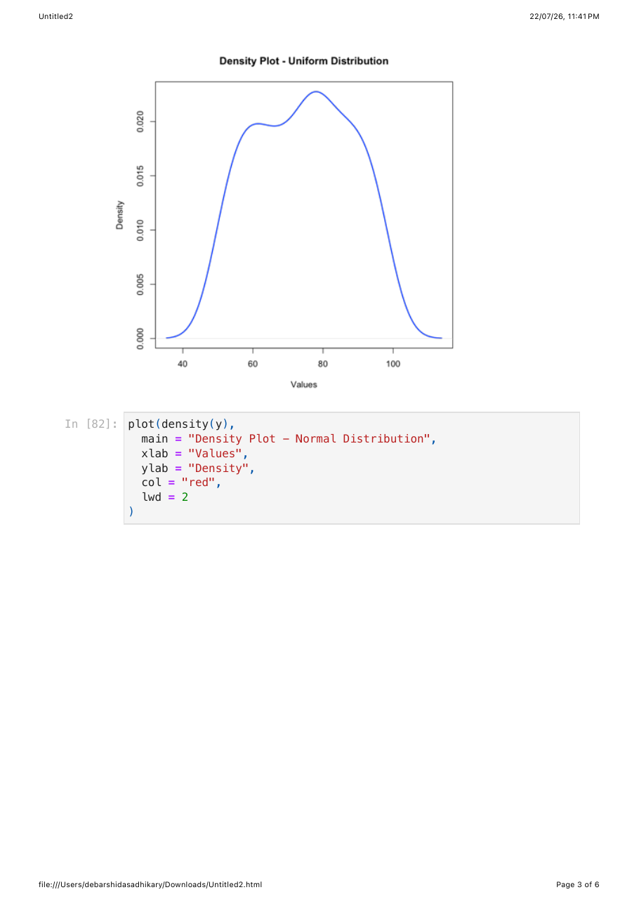
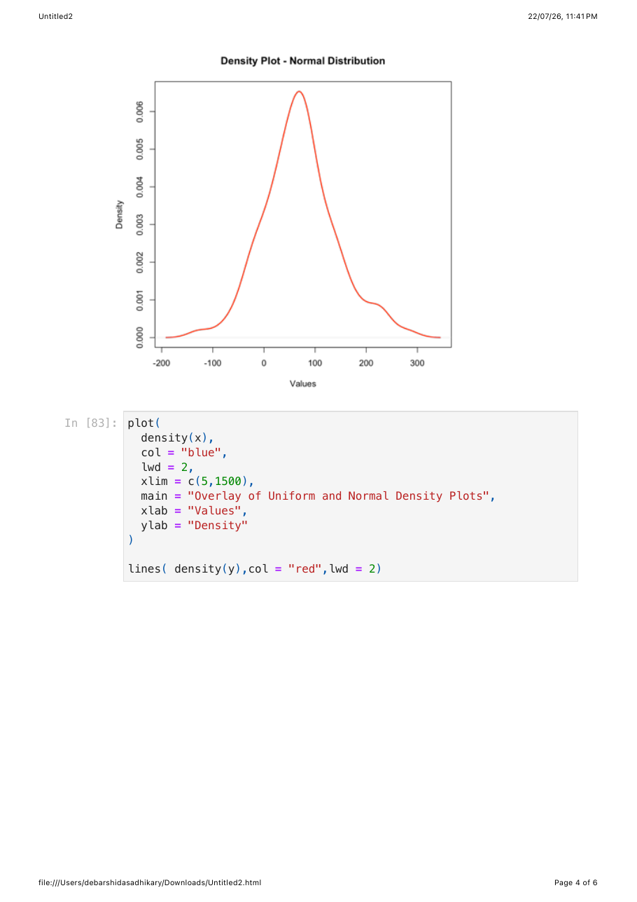
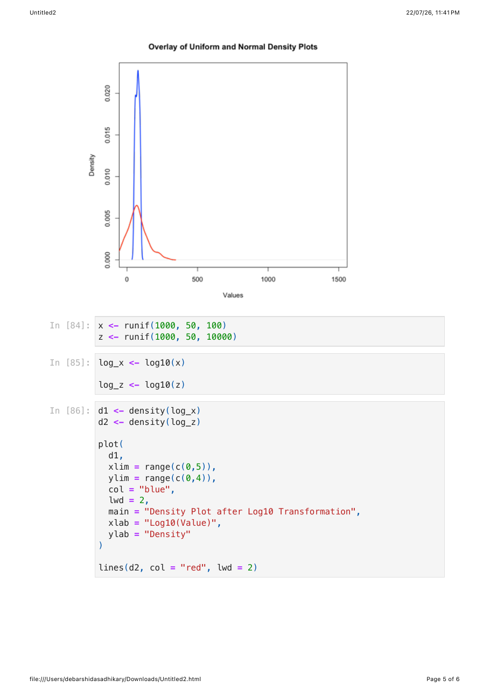
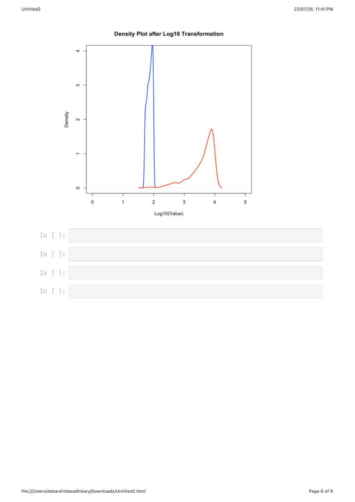

# R Distributions Basics (Lab 1)

**Aim:** Generate random numbers from a uniform and a normal distribution in R, compare their mean/median and density plots, and see the effect of a log10 transformation on density plots.
**Data / organism:** Simulated data only (`runif`, `rnorm`); no biological dataset.
**Tools:** R (base functions `runif`, `rnorm`, `mean`, `median`, `table`, `density`, `plot`, `lines`, `log10`), run in a Jupyter notebook.

## Procedure

1. Draw 100 values from a uniform distribution (`runif`, min = 50, max = 100) as `x` and 100 values from a normal distribution (`rnorm`, mean = 70, sd = 70) as `y`, then print them. `scripts/01_distributions_and_density.R`
2. Print mean and median of each sample with `cat()`. `scripts/01_distributions_and_density.R`
3. Tabulate `x` and report the most frequent value (`table`, `which.max`). `scripts/01_distributions_and_density.R`
4. Plot kernel density of `x` (blue), of `y` (red), and an overlay of both (`xlim = c(5,1500)`). `scripts/01_distributions_and_density.R`
5. Draw 1000 values from `runif(1000, 50, 100)` (`x`) and `runif(1000, 50, 10000)` (`z`), apply `log10` to both, and plot the two densities together (`xlim` 0-5, `ylim` 0-4). `scripts/02_log10_transform.R`

## Results

Printed summaries for the 100-value samples (the notebook also prints both full 100-value vectors; these are not reproduced here):

| Distribution | Mean | Median |
|---|---|---|
| Uniform (`x`) | 74.11535 | 74.95798 |
| Normal (`y`) | 69.91618 | 68.64402 |

Most frequent value in `x` (`names(table_x)[which.max(table_x)]`): `'50.3372855950147'`.

Density plot, uniform sample:



Density plot, normal sample:



Overlay of both densities:



Density plot after log10 transformation (blue: `x`, red: `z`):



## Interpretation

_The source notebook is a raw code + output export and contains no written interpretation._

## Files

```
01_r_distributions_basics/
├── README.md
├── scripts/   01_distributions_and_density.R, 02_log10_transform.R
├── results/   fig01-fig04 (page renders of the notebook, pages 3-6)
└── reports/   Debarshi_011_Lab1.pdf
```
