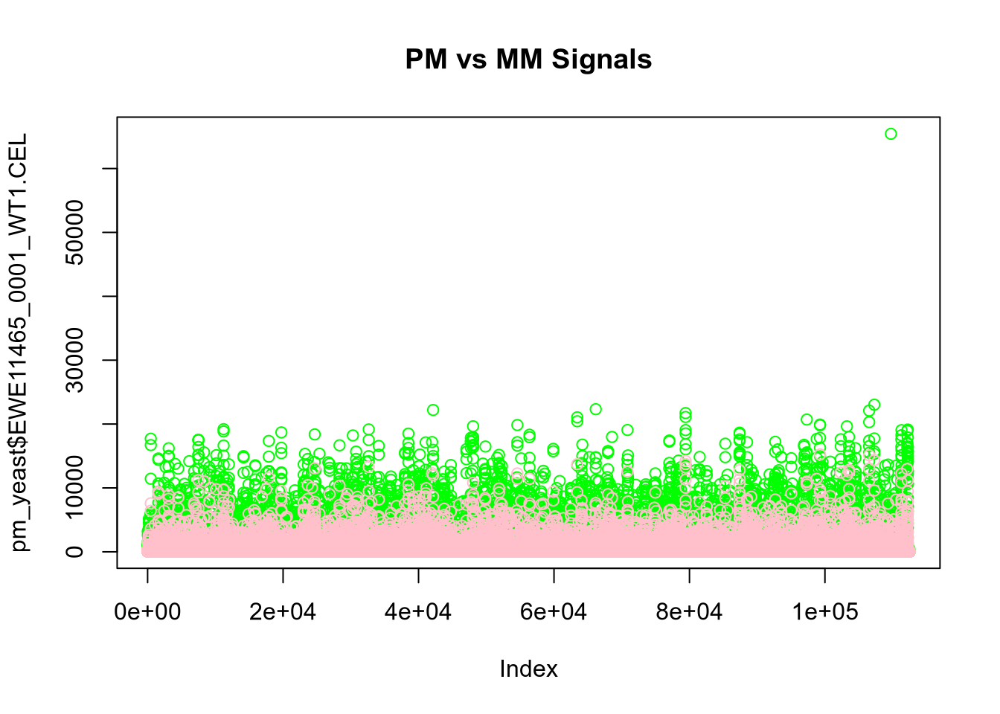
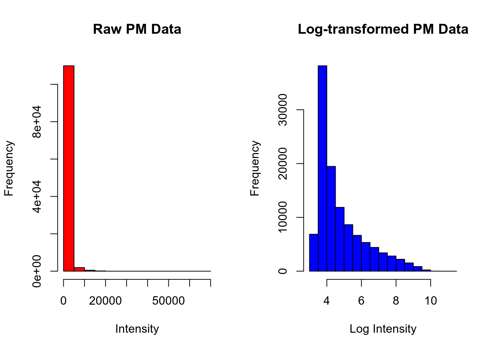
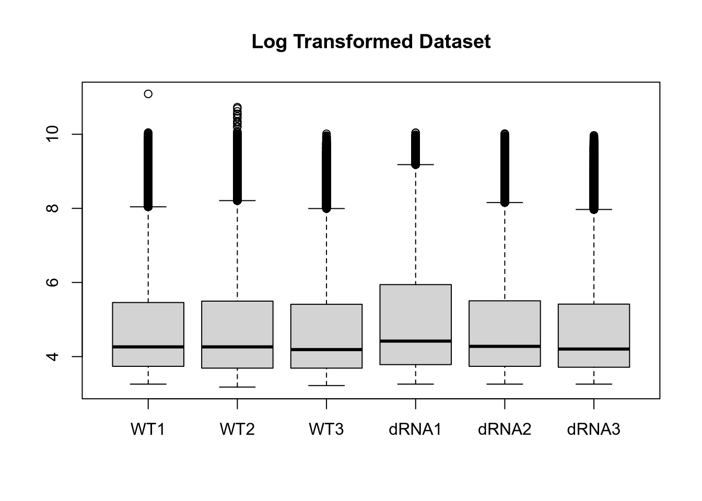
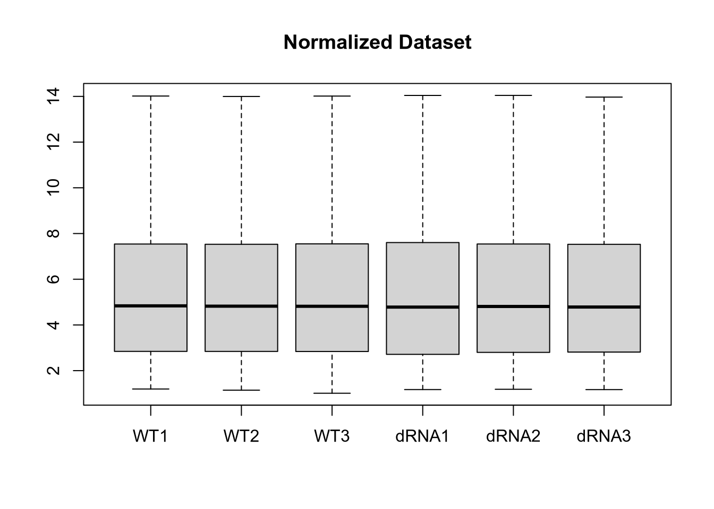
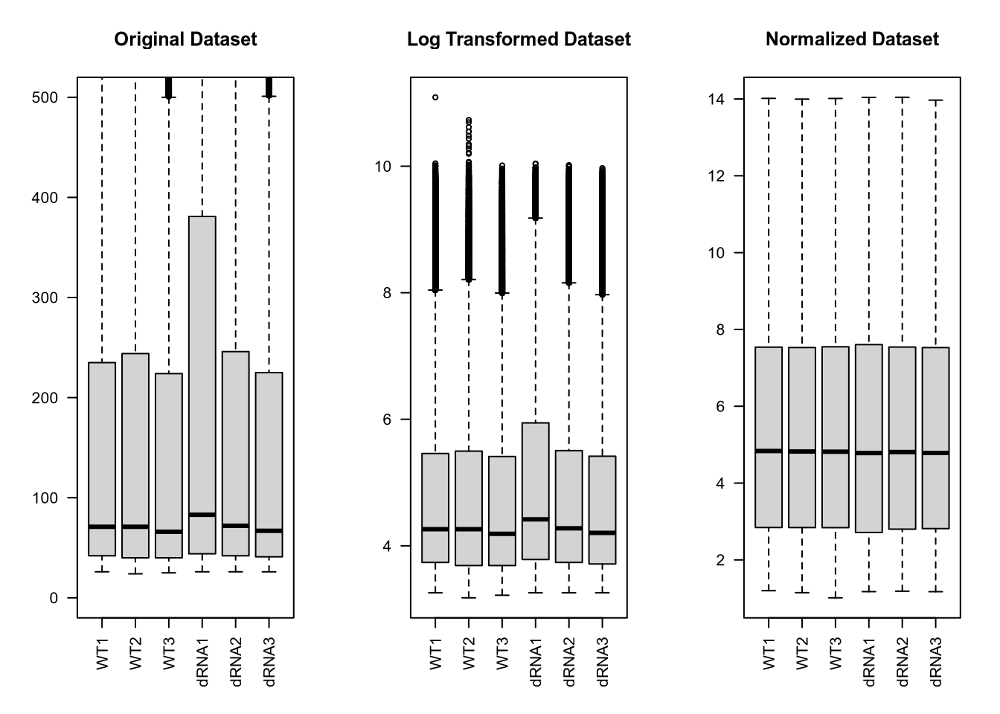
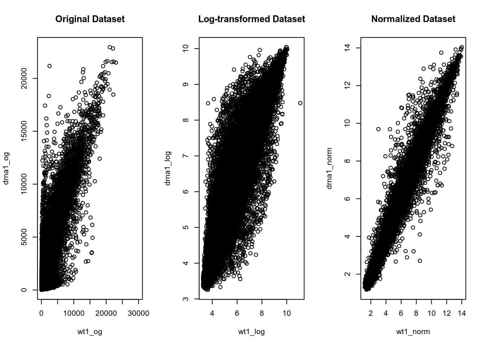
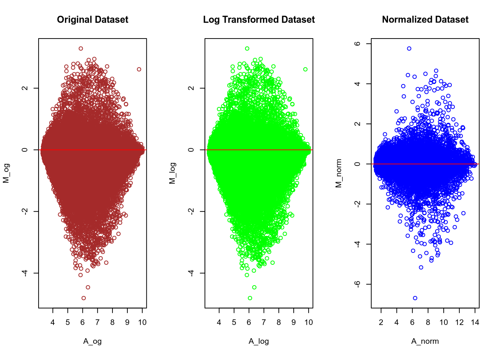
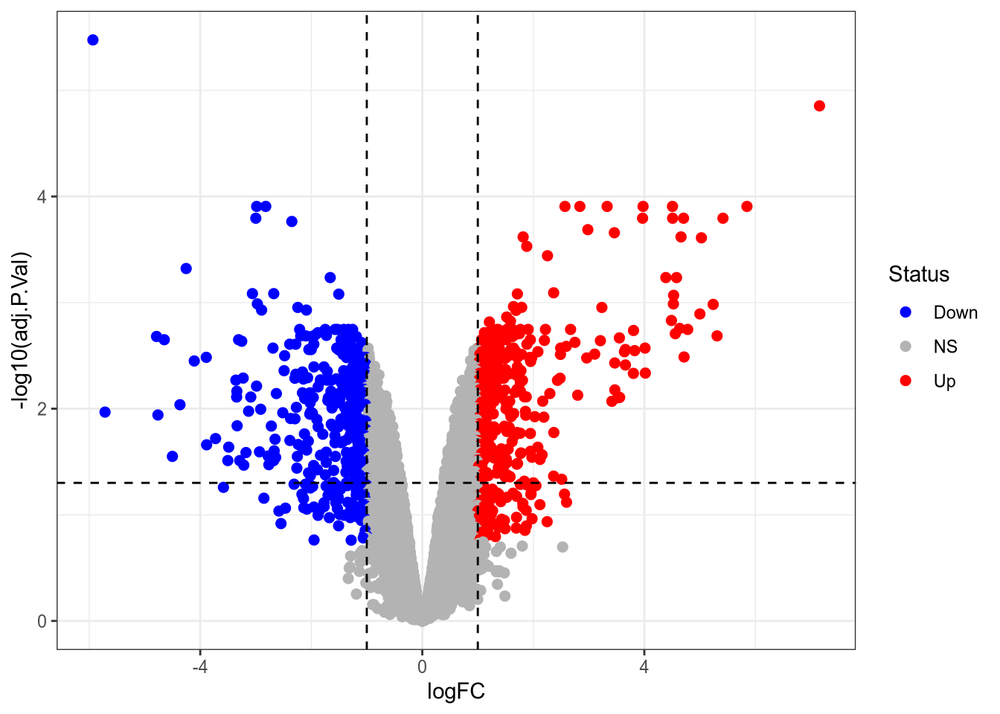

# Microarray differential expression: WT vs Mutant (affy RMA + limma)

**Aim.** Process Affymetrix CEL files, check raw/log/RMA-normalised intensities, then test WT vs Mutant for differential expression with limma (moderated t-test), plot a volcano plot, attach probe annotation and export up- and down-regulated probe lists.
**Data / organism.** Six CEL files `EWE11465_0001_WT1`, `_0002_WT2`, `_0003_WT3`, `_0004_drna1`, `_0005_drna2`, `_0006_drna3` (3 WT, 3 Mutant), read from `/home/ibab/bio-env`; the object is named `yeast_microchip`. Note: the package warnings mention `ecoli2cdf` and the annotation file (`EWE11465_18380_Results_021517.MAS5.TXT`) lists IDs such as `MG1655_mrr_b4351` and `EDL933_Z0312`.
**Tools.** R, affy, limma, tidyverse (ggplot2, dplyr).

Source PDFs: `day_2_Debarshi_Adhikary.pdf` is a subset of `day_3_Debarshi.pdf`, which is a subset of `Debarshi_day_4_011.pdf`. **`Debarshi_day_4_011.pdf` is the superset** and is the source of `scripts/` and `results/`; the other two are kept in `reports/`.

## Procedure
1. Read CEL files with `ReadAffy(celfile.path = celpath, compress = TRUE)`, take `exprs()` as a data frame and preview it (`scripts/01_affy_qc_rma.R`).
2. Extract Perfect Match (`affy::pm`) and Mismatch (`affy::mm`) probe signals; plot PM vs MM for WT1 (`scripts/01_affy_qc_rma.R`).
3. Natural-log transform PM/MM (`log()`); compare histograms of raw vs log PM for WT1; boxplot per sample (`scripts/01_affy_qc_rma.R`).
4. Normalise with `rma(yeast_microchip)` (background correction, normalisation, expression calculation); boxplot of RMA values (`scripts/01_affy_qc_rma.R`).
5. Compare original / log / RMA data side by side: boxplots, WT1-vs-dRNA1 scatter plots, and MA plots (A = mean, M = difference) (`scripts/01_affy_qc_rma.R`).
6. Define groups `c("WT","WT","WT","Mutant","Mutant","Mutant")` as a factor with WT as reference; build the no-intercept design `model.matrix(~0+Groups)`; `lmFit`, `makeContrasts(GroupsMutant-GroupsWT)`, `contrasts.fit`, `eBayes` (`scripts/02_limma_de_annotation.R`).
7. `topTable(fit12, number=Inf, adjust.method="BH")` for all probes; subset up (logFC >= 0.6 and adj.P.Val <= 0.05) and down (logFC <= -0.6 and adj.P.Val <= 0.05) (`scripts/02_limma_de_annotation.R`).
8. Volcano plot (logFC vs -log10 adj.P.Val; Up: logFC >= 1 and P.Value < 0.05, Down: logFC <= -1 and P.Value < 0.05; guide lines at logFC +/-1 and adj.P = 0.05) (`scripts/02_limma_de_annotation.R`).
9. Read the annotation file, keep `Probe Set ID`, `Representative Public ID`, `Gene Symbol`, `Gene Title`, `left_join` onto the results by probe ID, write `diffexp_annotated.csv`, and write `Upregulated_Genes.csv` (logFC >= 1) and `Downregulated_Genes.csv` (logFC <= -1) (`scripts/02_limma_de_annotation.R`).

## Results

**Raw intensities (first rows of `exprs()`, WT1 / WT2 / WT3 / drna1 columns).** Probe 1: 75 / 95 / 83 / 71; probe 2: 4530 / 4222 / 4416 / 4636; probe 3: 74 / 91 / 78 / 85; probe 4: 4918 / 4362 / 4714 / 4557.

PM vs MM signal for WT1 (PM green, MM pink):



Raw vs log-transformed PM histogram, WT1:



Boxplot of log-transformed PM for the six samples:



**RMA values (first rows, WT1 / WT2 / WT3):** 1759068_at 3.413791 / 3.015579 / 3.437268; 1759069_at 9.020832 / 9.126874 / 9.048895; 1759070_s_at 7.771956 / 7.623827 / 7.432955; 1759071_s_at 6.148551 / 5.695259 / 5.836691; 1759072_s_at 3.670370 / 3.580104 / 3.662050; 1759073_at 2.925485 / 3.253104 / 2.651791.



Original vs log vs RMA boxplots:



WT1 vs dRNA1 scatter plots (original, log, normalised):



MA plots (original, log, normalised):



**limma model.** Design columns `GroupsWT`, `GroupsMutant` (samples 1-3 = WT, 4-6 = Mutant); `df.residual` 4 per probe; eBayes `df.prior` 2.791656, `s2.prior` 0.03315848, `var.prior` 112.7717, `proportion` 0.01; `df.total` 6.791656; 10,203 further probes beyond the five printed. Example contrast coefficients (Mutant - WT): 1759068_at -0.24249026, 1759069_at -0.52167654, 1759070_s_at 1.29906777, 1759071_s_at -0.27378326, 1759072_s_at -0.04937133.

**Top 10 probes by `topTable` (BH-adjusted).** The table viewer reports 10,000 rows.

| Probe | logFC | AveExpr | t | P.Value | adj.P.Val | B |
|---|---|---|---|---|---|---|
| 1766647_s_at | -5.933308 | 5.554242 | -54.193405 | 3.280059e-10 | 3.348284e-06 | 11.564632 |
| AFFX-Ec-U57609-2_s_at | 7.155444 | 6.466314 | 39.603087 | 2.744066e-09 | 1.400571e-05 | 10.714404 |
| 1769071_s_at | -2.820358 | 10.795486 | -25.627512 | 5.180489e-08 | 1.241138e-04 | 8.933794 |
| 1765239_s_at | -2.983624 | 9.268889 | -25.254639 | 5.717466e-08 | 1.241138e-04 | 8.861778 |
| 1766702_s_at | 4.506791 | 9.075793 | 24.208565 | 7.599151e-08 | 1.241138e-04 | 8.649837 |
| 1764012_s_at | 2.838458 | 8.984151 | 23.819899 | 8.472505e-08 | 1.241138e-04 | 8.567176 |
| 1762388_s_at | 3.329537 | 5.449938 | 23.408790 | 9.523913e-08 | 1.241138e-04 | 8.477307 |
| 1763982_s_at | 5.848421 | 7.352742 | 23.187517 | 1.015131e-07 | 1.241138e-04 | 8.427870 |
| 1766364_s_at | 2.570210 | 8.176837 | 22.673929 | 1.179888e-07 | 1.241138e-04 | 8.310147 |
| 1762983_s_at | 3.976983 | 10.713461 | 22.572749 | 1.215848e-07 | 1.241138e-04 | 8.286452 |

**Gene counts.** logFC >= 0.6 and adj.P.Val <= 0.05: 636 probes up; logFC <= -0.6 and adj.P.Val <= 0.05: 554 probes down. After annotation, `up_annotated` (logFC >= 1) has 438 rows.



**Annotation.** The annotation file has 14 columns (`Probe Set ID`, six MAS5 signal columns, `Representative Public ID`, `Gene Title`, `Gene Symbol`, Gene Ontology BP/CC/MF, `Pathway`). Examples: 1759069_at = MG1655_mrr_b4351, gene symbol `mrr`; 1759071_s_at = MG1655_b2503, `ECs3365 /// yfgF`; 1759073_at = MG1655_ycfK_b1154, `stfP`. The joined table has 11 columns.

## Interpretation
The notebook contains no results discussion, only the student's own explanatory `##` comments on the method (kept in `scripts/02_limma_de_annotation.R`). They are quoted here, lightly cleaned of line-wraps.

**Student notes on the method**

- Groups: "We are grouping this, it groups first three as WT group and next three as Mutant, if it is in alternate order, we can write as WT, mutant, WT, mutant like this... order matters here, we can see two levels, if we write WT1 by mistake it will take that as another level, so instead of two here it will become three and WT1 will not have replicates."
- Factor / relevel: "Convert the character vector into a factor. Factors take the parameters in an alphanumeric way, which automatically detects what to compare with whom, order does not matter here. relevel tells what we are going to use as reference, it prevents use of that alphanumeric way, and specifically tells what to use as reference, but use of factor is important to tell how many levels are here."
- Design matrix: "We have to create a design matrix, here first three columns, it will take as wt because it has values of 1 for gene 1 and so on and will take the avg."
- `~0+Groups`: "the first 0 ... tells to take intercept as 0. No intercept model is also called as means model. Without 0, it will keep the intercept and that will be the mean reference model, there I will get only one column that is mutant. In the means model, if I get 9 in WT and * in Mutant, that states the avg intensity, but in mean reference model the values are in ratio."
- Averages: "Here the first three columns is 1 for WT, so while calculating the avg intensities from gene 1 for wild type it will take the first three column's intensities and put in the formula of B0WT+B1MT, where it will multiply 0 with the values of next three columns which is effectively mutant types, so we will get avg intensity values for WT for gene1. but the avg will be calculated using lmfit."
- `makeContrasts`: "Considering WT as reference, and we are comparing against mutants. This is important, if the values are positive it will say that the genes are upregulated in mutants." and "makeContrasts is for defining contrasts, where it is telling to take the differences between mutant and wild type. So it is like specifically defining condition of interest for us."
- `contrasts.fit`: "contrast matrix and design matrix does not have the avg intensity values, so we are using fit_y here, fit_y have the avg intensity values, variances, SE etc of all the columns, defined by the design matrix. And if there are multiple groups like WT1, MT1, MT2 -- to compare and specify which two we are going to compare we can use contrast matrix."
- `eBayes`: "Here by eBayes we are using the moderated t-test. It borrows variance info from all the other genes and then calculate the avg and adjust the variances according to that."
- `topTable`: "from the eBayes we got log of Odds, pvalue etc... top table is used." and "adjusted p value calculated based on Benjamin hotchback correction (BH) and we are writing Inf to calculate fold diff and adj p value for all the genes/probes. It prints in the order of highest expression difference to lowest. If I have given 10 in the 'number' it will calculate for only 10 highest."
- Fold change: "the fold change is in log2 scale, 1 means 2 fold upregulation and -1 means 2 fold downregulation, 0.6 means 1.5 fold upregulation."
- Volcano plot: "now plot a volcano plot between log10(Adjpvalue) and logFC... to get to know that pvalue cut off suits the most for our data."
- Annotation: "we dont have gene id we have prob id, there is a annotation file we have downloaded, there it is present."

## Files
```
02_microarray_yeast_limma/
  README.md
  scripts/  01_affy_qc_rma.R  02_limma_de_annotation.R
  results/  fig01 ... fig08 (.png)
  reports/  day_2_Debarshi_Adhikary.pdf  day_3_Debarshi.pdf  Debarshi_day_4_011.pdf
```
