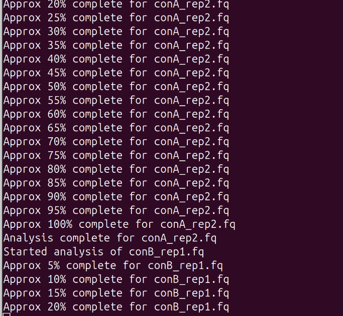
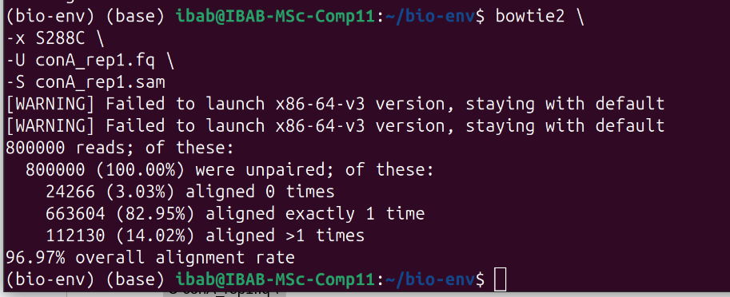
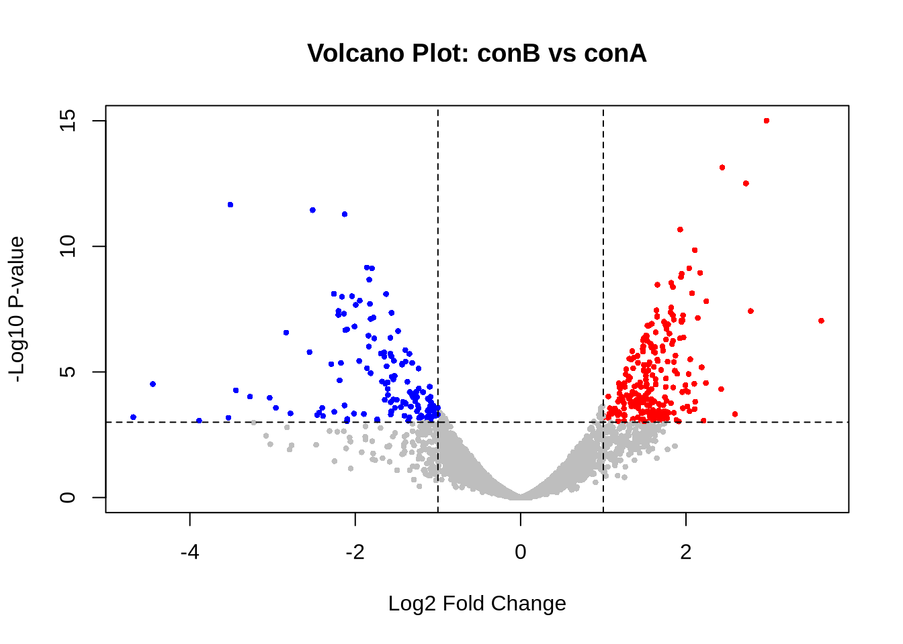
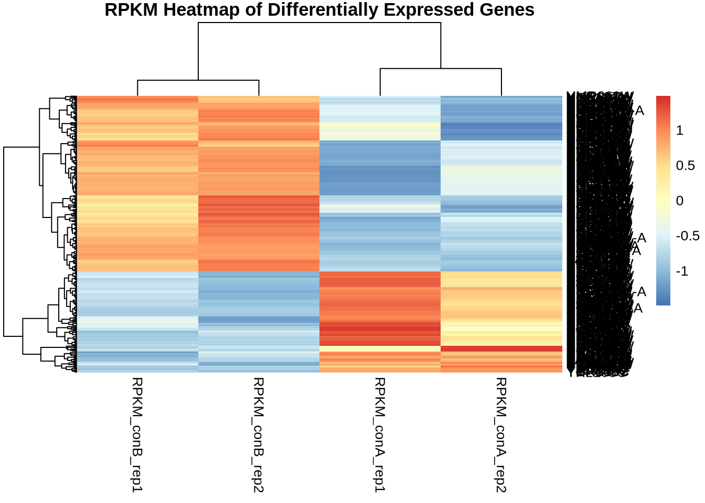
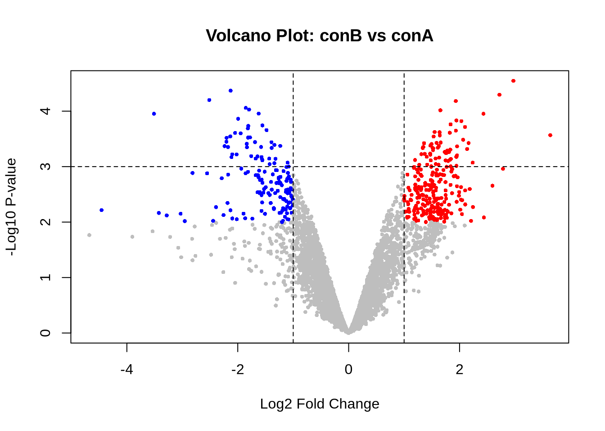
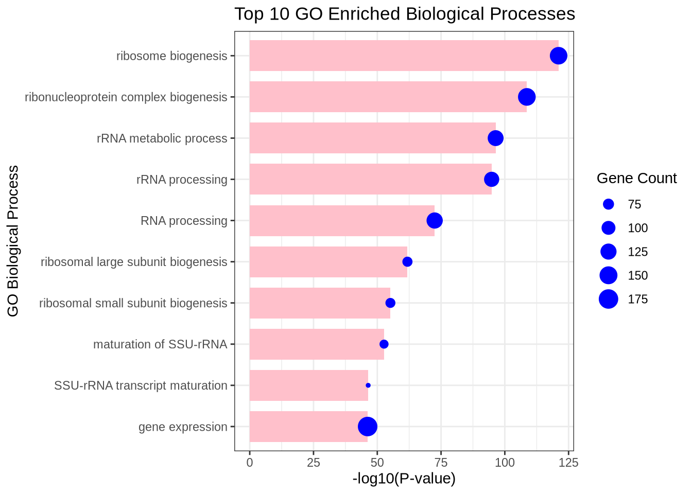
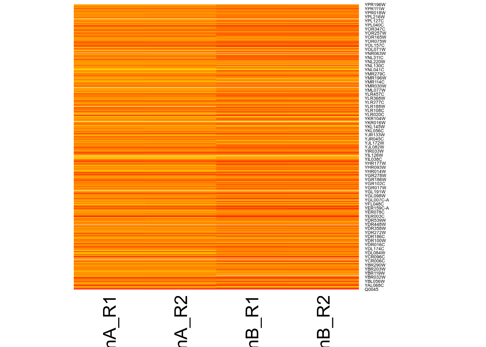

# RNA-seq: alignment, counting, differential expression (edgeR) and GO enrichment — *S. cerevisiae*

**Aim:** quantify gene expression in two yeast conditions (conA vs conB, 2 replicates each, single-end reads), find differentially expressed genes, and ask which biological processes they point to.
**Data:** conA_rep1/2 and conB_rep1/2 FASTQ; *S. cerevisiae* R64 genome (`GCF_000146045.2_R64_genomic.fna`) and GTF annotation.
**Tools:** FastQC, Bowtie2, Rsubread `featureCounts`, edgeR, ggplot2, pheatmap, gprofiler2.

## Procedure
1. **QC + alignment** (`scripts/01_align_bowtie2.sh`): FastQC on the four read files; build a Bowtie2 index of the R64 genome; align each file with `bowtie2 -x … -U … -S …sam`.
2. **Counting** (`scripts/02_featurecounts_edger_go.R`): `featureCounts` per SAM file on GTF `exon` features grouped by `gene_id`; the four count tables are combined into one count matrix.
3. **Filtering and normalisation:** `filterByExpr` (design `~0+group`), TMM normalisation (`calcNormFactors`), dispersion estimation (`estimateDisp`).
4. **Differential expression, two ways:**
   - classic `exactTest` (conA vs conB); up = logFC ≥ 1 and PValue ≤ 0.001, down = logFC ≤ −1 and PValue ≤ 0.001;
   - quasi-likelihood GLM (`glmQLFit` + `glmQLFTest`, contrast conB − conA); up/down at PValue ≤ 0.01.
5. **Visualisation:** volcano plots for both tests; RPKM computed from counts and gene length, log2(RPKM+1) heatmap of the DEGs (`pheatmap`, row-scaled, clustered).
6. **GO enrichment** of upregulated genes with `gprofiler2::gost` (organism `scerevisiae`, electronic annotations excluded, Bonferroni correction).
7. **RPKM / TPM normalisation and heatmap** (`scripts/03_rpkm_tpm_heatmap.R`, separate exercise on a raw count table `raw_count.xlsx` + `Scer_annotation.txt`): gene length = End − Start + 1; RPKM = count·10⁹ / (length · library size); TPM = (count/length_kb) / Σ(count/length_kb) · 10⁶; log2(TPM+1) heatmap.

## Results
**Alignment (conA_rep1):** 800,000 reads; 3.03 % aligned 0 times, 82.95 % exactly once, 14.02 % more than once; **96.97 % overall alignment rate**.




**featureCounts** (annotation: 6,831 features, 6,459 meta-features):

| Sample | Total alignments | Assigned |
|---|---|---|
| conA_rep1 | 800,000 | 721,531 (90.2 %) |
| conA_rep2 | 900,000 | 816,269 (90.7 %) |
| conB_rep1 | 700,000 | 633,555 (90.5 %) |
| conB_rep2 | 1,000,000 | 903,130 (90.3 %) |

**Filtering:** 5,224 of 6,459 genes kept by `filterByExpr`.

**Differential expression**

| Test | Threshold | Upregulated (conB vs conA) | Downregulated |
|---|---|---|---|
| exactTest | logFC ±1, PValue ≤ 0.001 | 235 | 135 |
| quasi-likelihood F-test | logFC ±1, PValue ≤ 0.01 | 255 | 148 |

The heatmap uses the 370 exactTest DEGs.





**GO enrichment (upregulated genes), top terms:** ribosome biogenesis (GO:0042254), ribonucleoprotein complex biogenesis (GO:0022613), rRNA metabolic process (GO:0016072), rRNA processing (GO:0006364), RNA processing (GO:0006396), ribosomal large subunit biogenesis (GO:0042273).



**RPKM/TPM exercise:** library sizes ConA_R1 9,263,208; ConA_R2 9,015,358; ConB_R1 16,593,821; ConB_R2 16,476,494. Each TPM column sums to exactly 1e6; RPKM columns sum to ~0.98–1.01 million.



## Interpretation
Written by the student in the notebook (GO figure):

> The x-axis displays statistical significance using −log10(P-value), meaning points further to the right carry higher statistical confidence. Pink bars indicate the overall enrichment level for each GO term, while the blue circles show the number of upregulated genes mapped to that term, where larger circles represent a higher gene count.
>
> Functional enrichment analysis reveals that genes upregulated in conB relative to conA are heavily focused on ribosome assembly and RNA processing. Ribosome biogenesis stands out as the single most enriched biological process, along with ribonucleoprotein complex assembly, rRNA metabolism, and pre-rRNA processing. Both small and large ribosomal subunit maturation terms are also strongly represented. Overall, these results indicate that switching from conA to conB primarily drives cellular investment into building ribosomes, processing rRNA, and scaling up the core translational machinery.

No written interpretation exists for the other steps in the source notebooks.

## Notes
- `Debarshi_15_8.pdf` is the superset of `Debarshi_13_08_part2.pdf` (adds GO enrichment). Both carry the title "day_8_genome_assembly", which is a mislabel; the content is RNA-seq.
- The Bowtie2 alignment was shown for conA_rep1; the PDF says it is to be repeated for all four files.

## Files
```
scripts/   01_align_bowtie2.sh  02_featurecounts_edger_go.R  03_rpkm_tpm_heatmap.R
results/   fig01–fig07 (.png)
reports/   Debarshi_13_8_part1.pdf  Debarshi_13_08_part2.pdf  Debarshi_15_8.pdf  day_5-1_Debarshi.pdf
```
