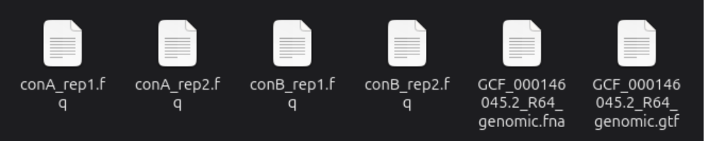
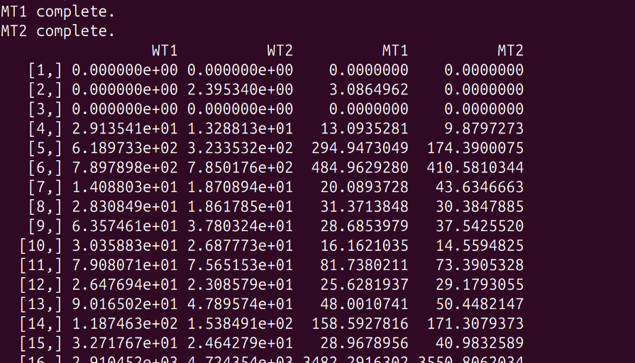
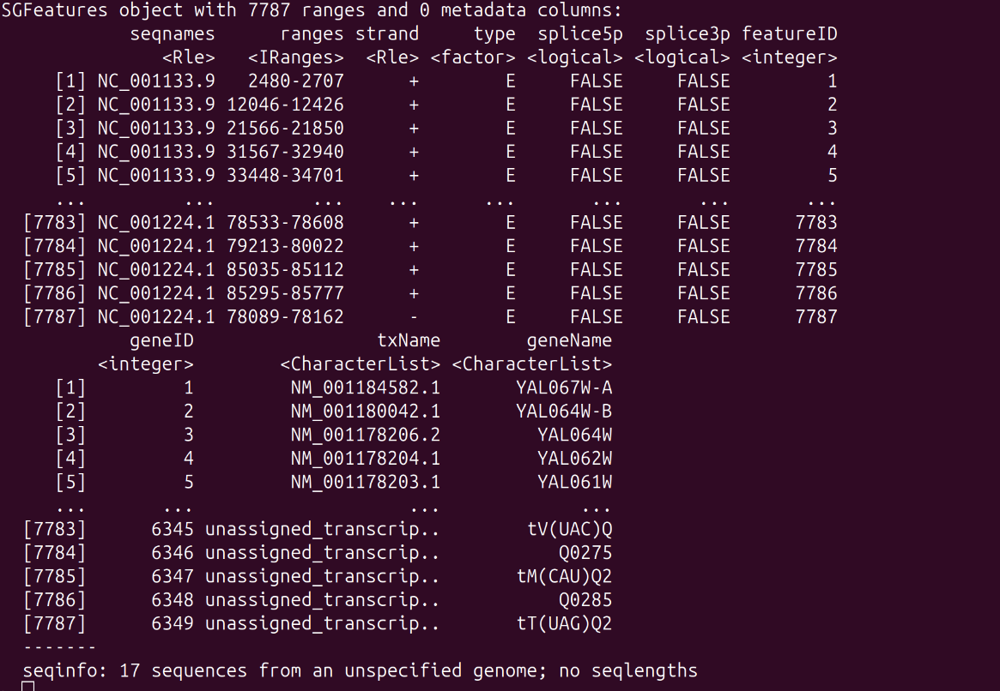
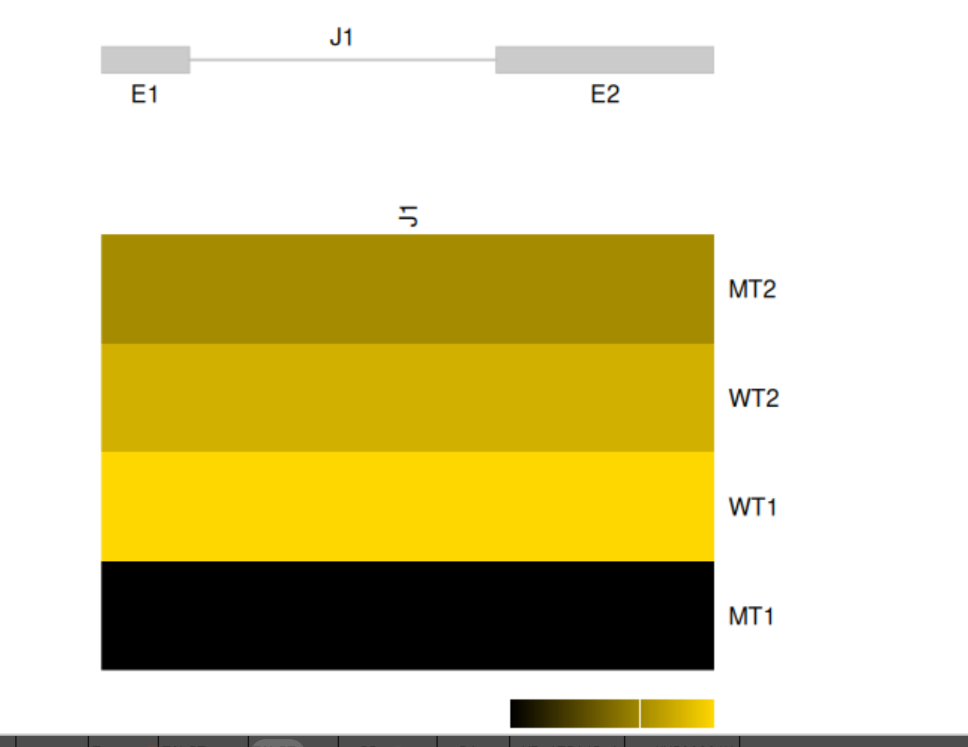
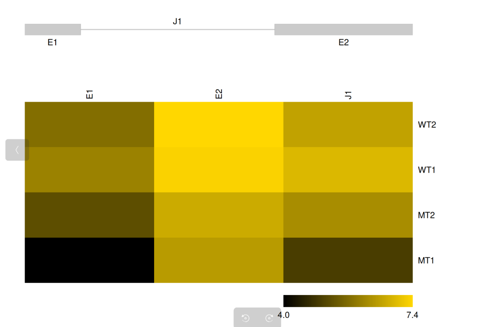
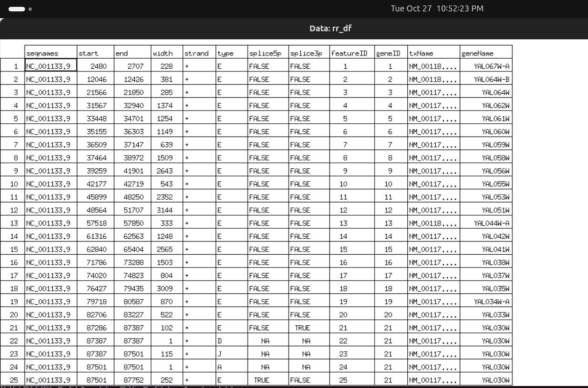
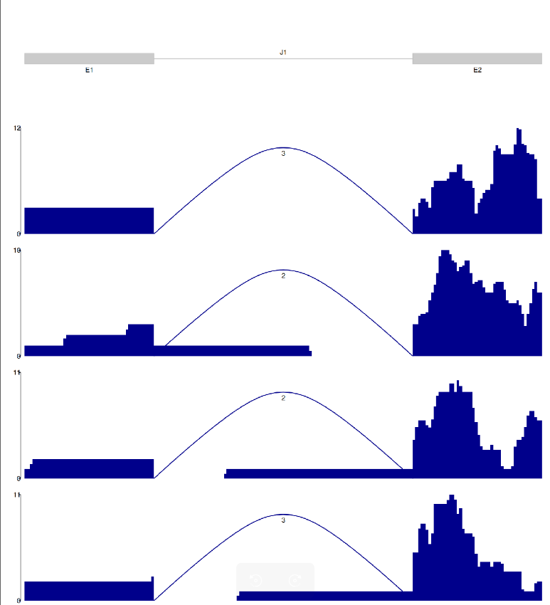

# Alternative Splicing Analysis of *Saccharomyces cerevisiae* RNA-Seq Data using HISAT2, SAMtools and SGSeq

**Aim** — To align single-end RNA-Seq reads from two conditions (wild type, WT, and mutant, MT; two replicates each) to the yeast reference genome, and to detect and visualise splice junctions and exons with the Bioconductor package SGSeq, in order to check whether the gene YAL030W shows any alternative splicing.

**Data / organism** — *S. cerevisiae* (R64). Reference genome `GCF_000146045.2_R64_genomic.fna`; annotation `GCF_000146045.2_R64_genomic.gtf`. Reads (all single-end): `conA_rep1.fq`, `conA_rep2.fq` (WT1, WT2) and `conB_rep1.fq`, `conB_rep2.fq` (MT1, MT2).

**Tools** — HISAT2 (spliced alignment), SAMtools (SAM/BAM handling), R/RStudio with SGSeq (splice graph analysis).

## Procedure

Part A, terminal (`scripts/01_align.sh`):
1. Create and activate a conda environment with hisat2 and samtools (`conda create -n altsplice ...`), check versions.
2. `hisat2-build` the reference genome into the index `Hisat_index`.
3. `hisat2 -x Hisat_index -U <reads> -S <sample>.sam` for the four single-end read files (A_1, A_2, B_1, B_2).
4. `samtools view -bS` to convert SAM to BAM.
5. `samtools sort` to sort the BAM files.
6. `samtools index` the sorted BAM files.

Part B, RStudio (`scripts/02_sgseq_analysis.R`):
7. Install/load SGSeq; build the sample table (columns must be exactly `sample_name` and `file_bam`: WT1, WT2, MT1, MT2).
8. `getBamInfo()` to extract BAM information.
9. `importTranscripts()` + `convertToTxFeatures()` to import the GTF annotation.
10. `analyzeFeatures()` to predict features and quantify them (`FPKM()`, `rowRanges()`).
11. `plotFeatures()` for YAL030W, then a modified `plotFeatures_fixed()` (matches by featureID first, then by name, drops NA entries) with `geneID = 21`, `include = "both"`.
12. `plotSpliceGraph()` and `plotCoverage()` for the gene (`geneID = 505` as written in the code), saved as `splicegraph_coverage.png`.

The input files in the working folder are shown below.



## Results

**HISAT2 alignment summary (for the sample shown):**

```
800000 reads; of these:
  800000 (100.00%) were unpaired; of these:
    31586 (3.95%) aligned 0 times
    717191 (89.65%) aligned exactly 1 time
    51223 (6.40%) aligned >1 times
96.05% overall alignment rate
```

**BAM information (`getBamInfo`):**

| sample_name | file_bam | paired_end | read_length | frag_length | lib_size |
|---|---|---|---|---|---|
| WT1 | A_1_sorted.bam | FALSE | 101 | NA | 768414 |
| WT2 | A_2_sorted.bam | FALSE | 101 | NA | 867936 |
| MT1 | B_1_sorted.bam | FALSE | 101 | NA | 673580 |
| MT2 | B_2_sorted.bam | FALSE | 101 | NA | 961359 |

**SGSeq features.** The SGFeatures object contains 7,787 ranges.





**YAL030W (gene ID 21)** has five features: exon 87286-87387 (102 bp), splice donor (D) at 87387, junction (J) 87387-87501 (115 bp), splice acceptor (A) at 87501, and exon 87501-87752 (252 bp). In the plots: E1, J1, E2.







Junction-spanning reads: 3 (WT1), 2 (WT2), 2 (MT1), 3 (MT2). Maximum coverage on the y axis: about 12 (WT1), 19 (WT2), 11 (MT1 and MT2).



## Interpretation

(From section "4. Results and Interpretation" and "5. Conclusion" of the PDF.)

### 4.1 Alignment quality
Out of 800,000 single-end reads, 96.05% aligned to the reference genome. 89.65% (717,191 reads) aligned uniquely and 6.40% (51,223 reads) aligned to more than one location, while only 3.95% (31,586 reads) did not align. A high overall alignment rate with mostly unique hits shows that the reads are of good quality, the correct reference was used, and the data are suitable for splice junction analysis.

### 4.2 BAM information and library sizes
All four samples are single-end (paired_end = FALSE) with a read length of 101 bp, so the fragment length is NA. The library sizes differ: WT1 = 768,414, WT2 = 867,936, MT1 = 673,580 and MT2 = 961,359 reads. MT1 is the smallest and MT2 the largest library (about 1.4 times larger), so raw read counts cannot be compared directly between samples. This is why expression was compared as FPKM, which normalises for both library size and feature length.

### 4.3 Annotation and features (Figure 3)
The SGFeatures object contains 7,787 ranges. The first entries are exons (type E) on NC_001133.9 (chromosome I) with gene names such as YAL067W-A, YAL064W-B and YAL064W, and the last entries belong to non-coding genes (tRNAs and others, for example tV(UAC)Q and Q0275) on the mitochondrial sequence NC_001224.1. The columns splice5p and splice3p are FALSE for most exons, which means that most annotated exons are not flanked by a splice site, as expected in yeast, where the majority of genes have no introns. The note "17 sequences from an unspecified genome; no seqlengths" only means that chromosome lengths were not stored in the object; it is not an error.

### 4.4 FPKM values (Figure 2)
The FPKM table has one row per feature and one column per sample. Some features (rows 1 and 3) have FPKM of 0 in all samples, which means they are not expressed or have no reads. Other features are expressed at very different levels, from about 10 to several thousand FPKM (for example row 6: 789.8, 785.0, 485.0 and 410.6 in WT1, WT2, MT1 and MT2; row 16 reaches the thousands). In many rows the two WT samples have higher values than the two MT samples (rows 5, 6 and 7 are clear examples), but the two replicates of the same condition are close to each other, which indicates good reproducibility. The reverse is also seen in a few rows (for example rows 14 and 15 show higher values in MT), so the changes are feature specific and not a general shift.

### 4.5 Gene YAL030W: exons and junction (Figures 4, 5 and 6)
The rr_df table shows that gene ID 21 (YAL030W) has five features: an exon at 87286 to 87387 (102 bp, splice site at its end), a splice donor (type D) at 87387, a junction (type J) from 87387 to 87501 (115 bp), a splice acceptor (type A) at 87501, and a second exon at 87501 to 87752 (252 bp, splice site at its start). In the plots these are named E1, J1 and E2. So YAL030W has only one annotated splicing event: E1 is joined to E2 by J1, and the intron lies between them. No alternative exon or alternative junction is present in the splice graph.

Figure 4 (default plotFeatures) shows only the junction J1 as a single heat map column. J1 is brightest in WT1, slightly less bright in WT2 and MT2, and darkest (black) in MT1. That means the splicing junction is supported by the most reads in WT1 and by the fewest reads in MT1. A single column is difficult to compare, so the modified function was used.

Figure 5 (modified function, both exons and junction) shows E1, E2 and J1 as columns and the four samples as rows. The colour scale is log2(FPKM + 1) and runs from 4.0 (black, low) to 7.4 (gold, high). Exon E2 is bright in all four samples, so it is the most highly expressed part of the gene, and it is similar in WT1, WT2 and MT2 and a little lower in MT1. Exon E1 is darker than E2 in every sample and is nearly black in MT1, so MT1 has the lowest expression of E1. The junction J1 has intermediate intensity: higher in WT1 and WT2 and lower in MT2 and MT1. Overall, the WT samples show a little higher expression of E1 and J1 than the MT samples, and MT1 is the lowest in all features. Since MT1 also has the smallest library, part of this difference may be a sampling effect, and with only two replicates per condition the difference cannot be called statistically significant.

### 4.6 Splice graph and coverage (Figure 7)
The top panel is the splice graph of the gene: two exons (E1 and E2, grey boxes) connected by one junction J1 (line). Novel features would be drawn in red because of color_novel = "red", but no red feature is present, so no novel splice site or novel exon was found. The four lower panels show the read coverage of WT1, WT2, MT1 and MT2. The arc over the intron represents reads that span the junction, and the number on the arc is the junction read count: 3 reads in WT1, 2 in WT2, 2 in MT1 and 3 in MT2. The maximum coverage on the y axis is about 12 for WT1, 19 for WT2 and 11 for MT1 and MT2.

In all four samples the coverage is low and almost flat in E1 (about 2 to 3 reads) and much higher and uneven in E2, with peaks up to 12 to 19 reads. This agrees with the heat map, where E2 was brighter than E1. In the intron region there is almost no coverage in WT1, while a thin line of about 1 read appears in WT2, MT1 and MT2. This low-level signal may come from a few unspliced or partially processed transcripts or from background, but it is far too small to indicate intron retention.

All four samples have the same pattern, that is, E1 spliced to E2 through J1, with the same junction. The differences between WT and MT are in the amount of reads, not in the way the gene is spliced.

### 5. Conclusion
The reads aligned well to the *S. cerevisiae* genome (96.05% overall alignment). SGSeq identified 7,787 features in the annotation and quantified them as FPKM in the WT and MT samples. For the gene YAL030W, one splice junction (J1) connecting two exons (E1 and E2) was found, and it is present in all four samples with 2 to 3 junction-spanning reads each. No alternative splice isoform and no novel splicing event was detected for this gene. E2 is the most highly covered region, and WT samples show slightly higher E1 and J1 expression than MT samples, but this is based on few reads and two replicates only, so a statistical test with more replicates would be needed to confirm any difference.

## Files

```
04_alternative_splicing_sgseq/
├── README.md
├── scripts/   01_align.sh, 02_sgseq_analysis.R
├── results/   fig01 ... fig07 (.png)
└── reports/   Alternative_Splicing_Analysis_Debarshi_Das_Adhikary-1.pdf
```
