# ChIP-seq: peak calling, differential binding (DiffBind) and motif analysis

Two ChIP-seq experiments, kept together because they share the same pipeline logic (align → call peaks against input → annotate → motifs).

| | **A. TF ChIP-seq, *E. coli* BW25113** | **B. WT vs Mutant ChIP-seq, yeast (dGcn4)** |
|---|---|---|
| Aim | Call and annotate peaks for a transcription factor in two samples (C, D) and look for a binding motif | Process paired-end ChIP-seq of WT and Mutant (2 replicates each + inputs) to peak calling and test for differential binding |
| Reads | single-end `SO_4933_{C,D}_{CHR1,INR1}_R1.fastq.gz` | paired-end ChIP `C1, C2, MC1, MC2` and input `I1, I2, MI1, MI2` (`_R1/_R2`) |
| Tools | Bowtie2, samtools, MACS3, IGV, HOMER, bedtools, MEME | BWA-MEM, samtools, MACS3, deepTools, IGV, DiffBind (DESeq2), HOMER |
| Script | `scripts/01_…sh` | `scripts/02`–`05` |

## Procedure
### A. E. coli TF (`scripts/01_chipseq_ecoli_align_macs3_motifs.sh`)
1. Align ChIP and input reads of samples C and D with Bowtie2, sort and index with samtools.
2. Call peaks with MACS3 (`-g 4.6e6 --nomodel --extsize 150 -p 0.001 -B`) using the matching input as control.
3. Inspect narrowPeak files in IGV.
4. Merge peaks (`mergePeaks -d 300`).
5. Annotate peaks with HOMER `annotatePeaks.pl` (E. coli FASTA + GFF).
6. Find nearest genes with `bedtools closest` (keeping rows where feature = gene).
7. Extract peak sequences with `bedtools getfasta` (one FASTA entry per peak) and run `meme -dna -nmotifs 3`.

### B. WT vs Mutant (`scripts/02`–`05`)
1. Index reference (`bwa index`, `samtools faidx`); align every ChIP and input pair with `bwa mem`, pipe into `samtools sort`, index.
2. Call narrow peaks (`macs3 callpeak -f BAMPE -B`) and broad peaks (`--broad`) per replicate against its input.
3. RPKM-normalised BigWig tracks with `bamCoverage` (bin size 10); view in IGV at an identical data range.
4. Build `sample_sheet.csv` (`03_make_samplesheet.sh`) and run DiffBind in R (`04_diffbind_analysis.R`): `dba` → `dba.count` → `dba.normalize` → `dba.contrast` (by Condition) → `dba.analyze` (DESeq2) → `dba.report`; significant regions at FDR < 0.05.
5. Peak-length summary per sample; export significant regions as BED; HOMER annotation and `findMotifsGenome.pl -size 200` (`05_homer_annotation_motifs.sh`).

## Results
### A. E. coli TF
Alignment summaries (ChIP C, input C, ChIP D, input D):

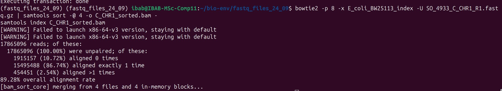
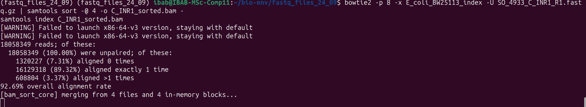

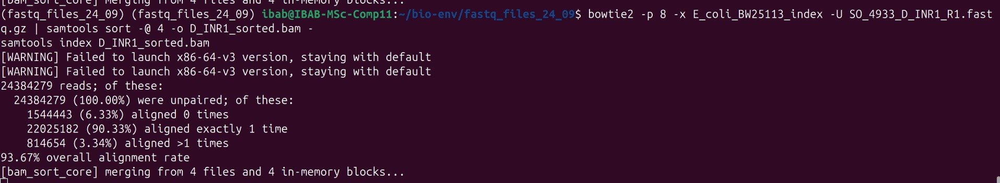

Peak calling and genome-browser views:

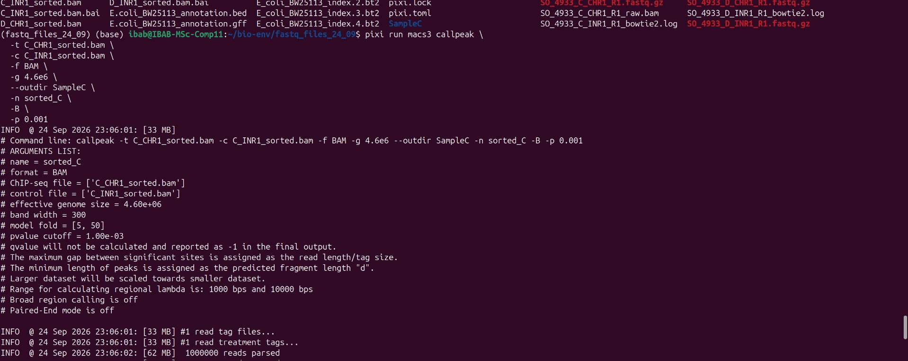
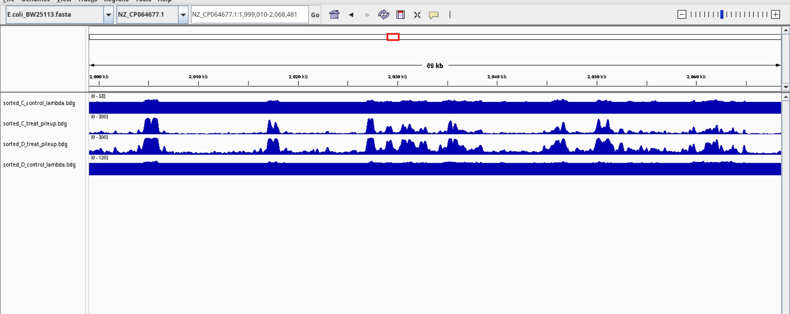
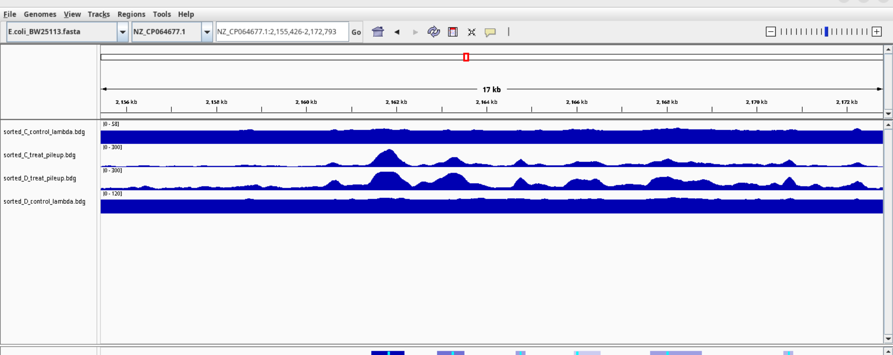
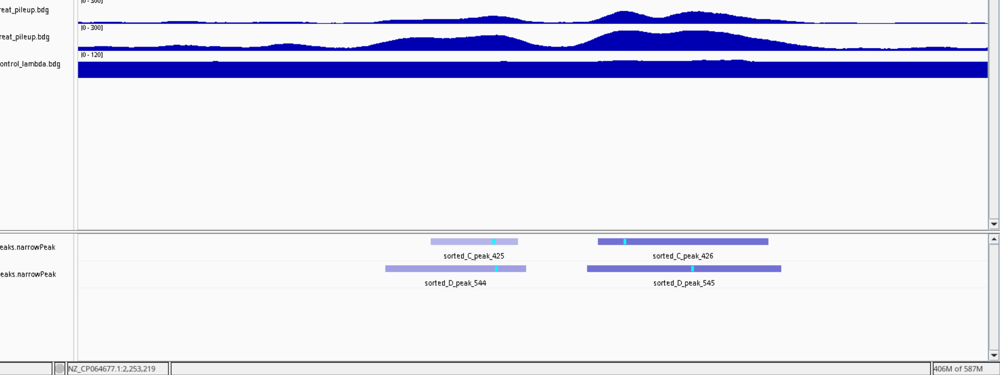

Merging, annotation, nearest genes:

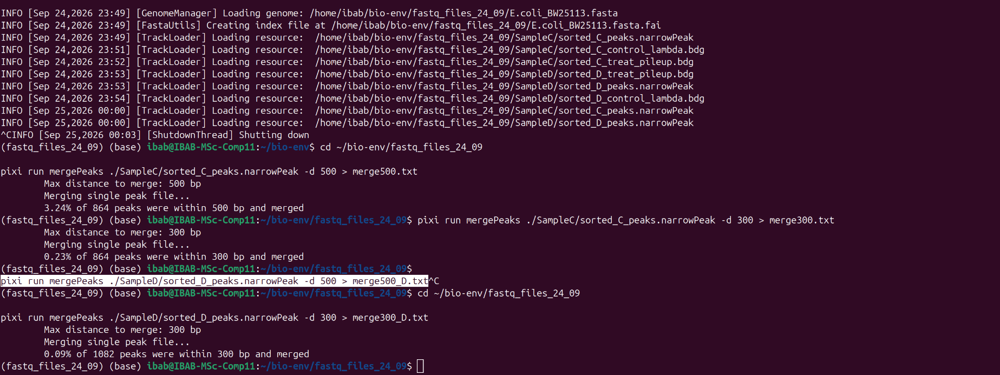
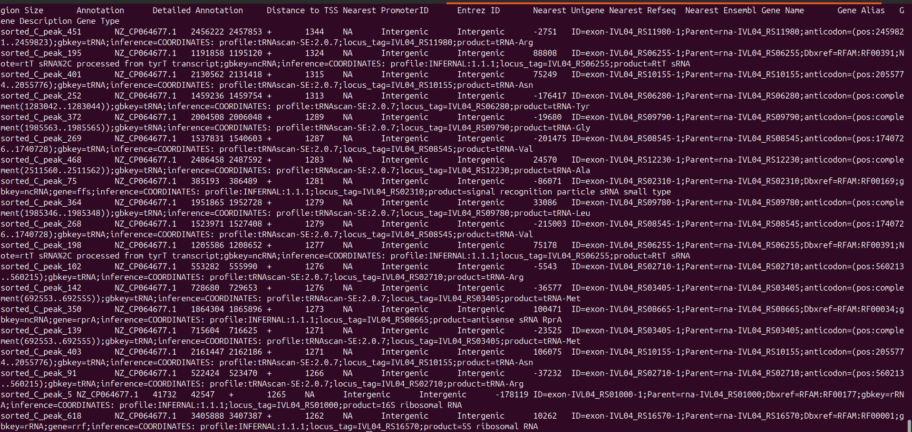
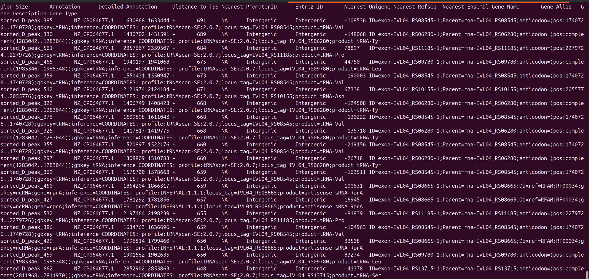
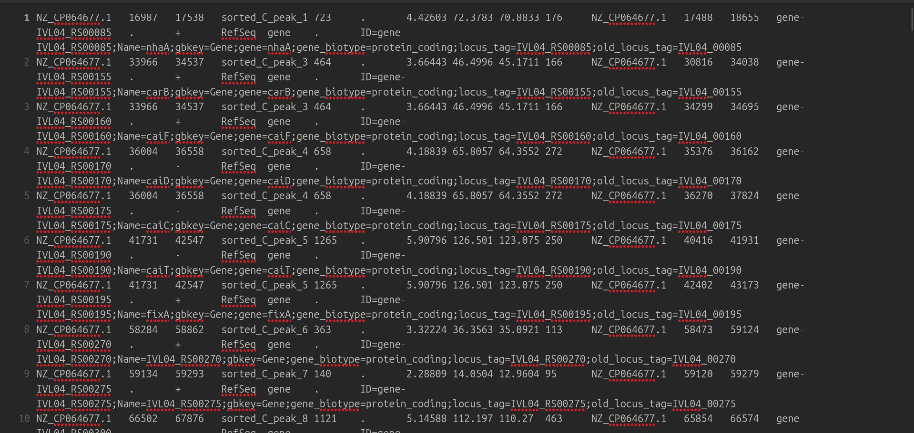

MEME motif discovery:

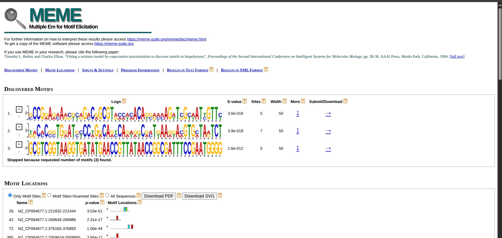
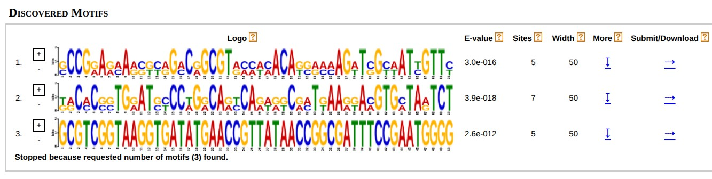

### B. WT vs Mutant
**DiffBind counting** (first run, as printed in the report): 4 samples; consensus matrix of 1,110 sites after counting (1,122 of 2,848 before).

| Sample | Condition | Peaks (intervals) | Reads in library | FRiP |
|---|---|---|---|---|
| S1 | WT rep 1 | 1,188 | 3,147,941 | 0.08 |
| S2 | WT rep 2 | 1,818 | 3,520,038 | 0.08 |
| S3 | Mutant rep 1 | 1,412 | 776,190 | 0.09 |
| S4 | Mutant rep 2 | 98 | 434,654 | 0.08 |

Default (library-size) normalisation: factors 1.5982, 1.7871, 0.3941, 0.2207 → all four libraries scaled to 1,969,706 reads.

**Differential binding (DESeq2, Mutant vs WT):** 1,110 regions tested; **26 significant at FDR < 0.05 — 22 enriched in Mutant, 4 enriched in WT**. A later memory-safe re-run (`export_results.R`) printed 1,108 regions, 27 significant (23 Mutant-enriched, 4 WT-enriched).

**Peak lengths (narrowPeak):**

| Sample | Peaks | Min | Median | Mean | Max |
|---|---|---|---|---|---|
| Mutant_Rep1 | 1,412 | 122 | 249 | 283 | 997 |
| Mutant_Rep2 | 98 | 109 | 188 | 231 | 989 |
| WT_Rep1 | 1,188 | 140 | 248 | 320 | 2,356 |
| WT_Rep2 | 1,818 | 139 | 257 | 341 | 2,299 |

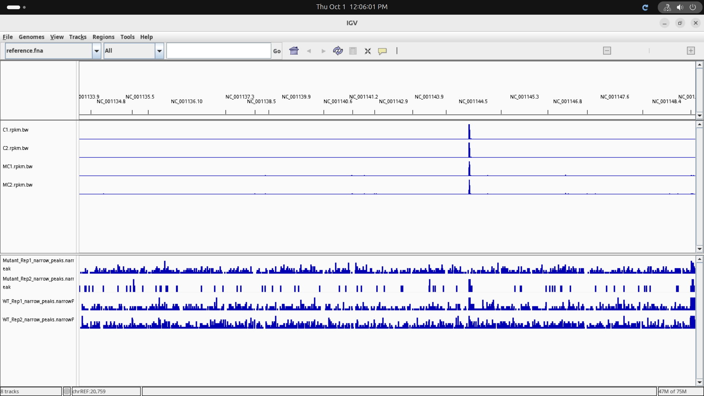
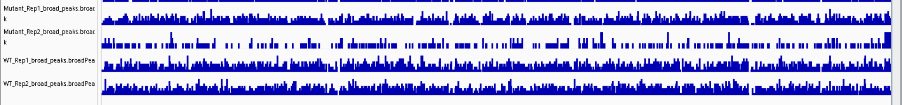
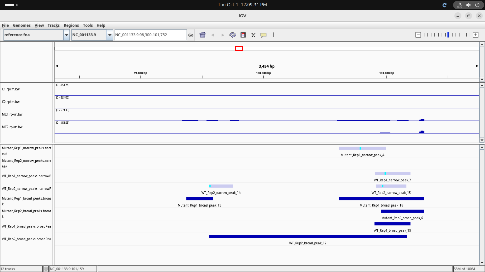
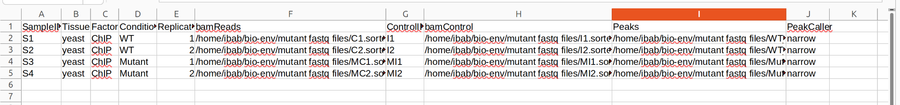
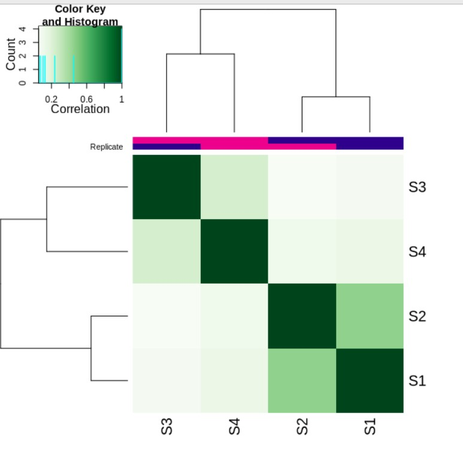
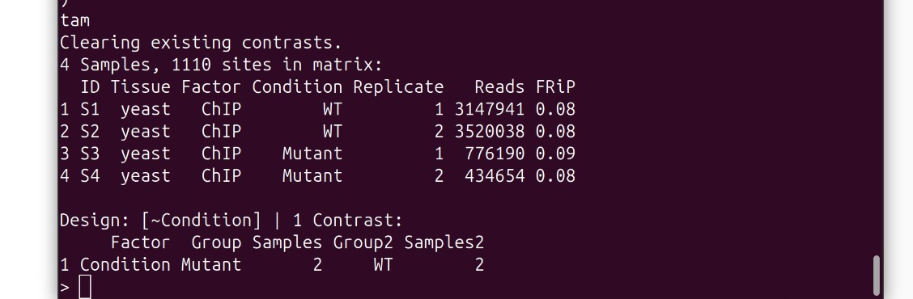
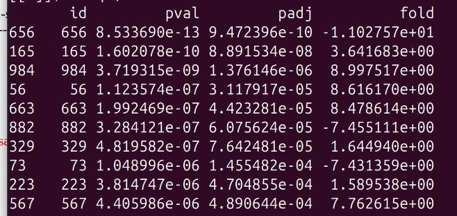
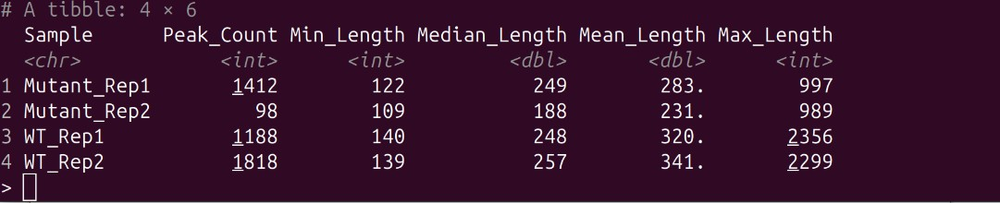
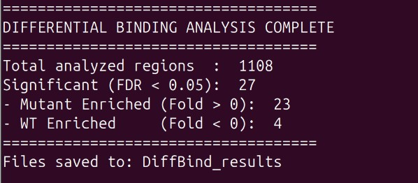
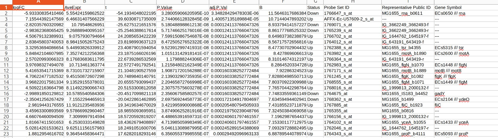
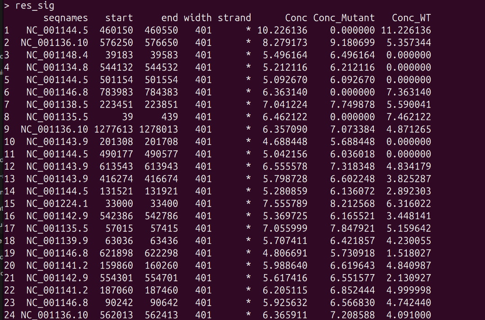
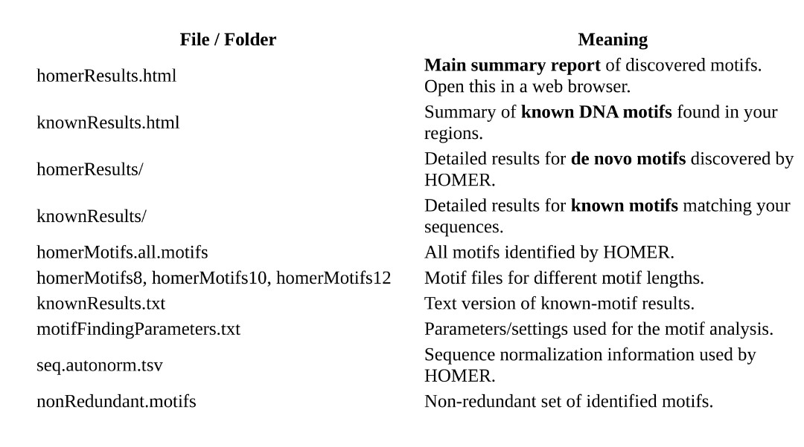
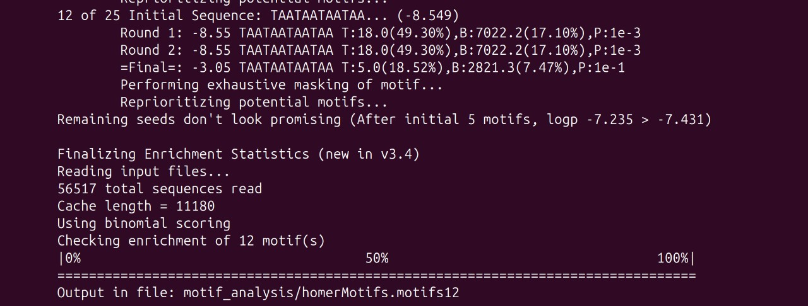
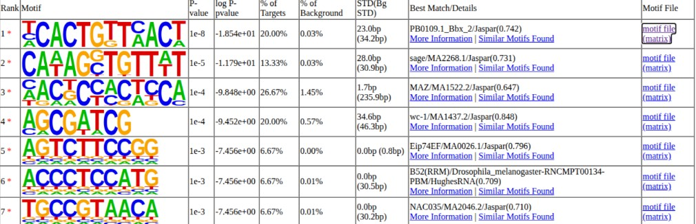

## Interpretation
### A. E. coli TF (student's own notes)
- Samples C and D have almost the same number of peaks (same transcription factor), but sample C has lower and sample D higher expression, so broader peaks and a few more low-intensity peaks appear in sample D when the narrowPeak files are loaded in IGV (higher protein concentration in D).
- Annotation: most peak regions are intergenic; since the protein is a transcription factor these could be promoter regions.
- Motif discovery: the TF does not show a specific binding motif; the result is a long stretch of motifs that are mostly AT-rich, which is the only specificity seen for this TF.

### B. WT vs Mutant (from the report, "Biological & Analytical Interpretation")
- **Replicate concordance:** high-confidence binding events should appear in both biological replicates; discrepant peaks often reflect technical noise, PCR amplification bias or low read depth.
- **ChIP vs input:** true protein–DNA sites show sharp enrichment in ChIP with low, flat input coverage; regions elevated in both are non-specific artefacts, copy-number amplifications or repeats.
- **Narrow vs broad:** sharp tall peaks with high fold enrichment are typical of sequence-specific TF binding; wide plateau-like peaks spanning kilobases indicate chromatin-modifying complexes or histone marks (e.g. H3K27me3, H3K9me3).
- **Output files:** narrowPeak column 5 = normalised score (−10·log10 q), column 7 = fold enrichment, column 10 = summit offset; broadPeak has no single-base summit; `.xls` lists pileup, fold enrichment, −log10 p and q.


## Files
```
scripts/   01_chipseq_ecoli_align_macs3_motifs.sh  02_wt_vs_mutant_align_peakcall_bigwig.sh
           03_make_samplesheet.sh  04_diffbind_analysis.R  05_homer_annotation_motifs.sh
results/   chipseq_fig01–14, diffbind_fig01–14 (.png)
reports/   Debarshi_chip_seq_analysis_24_09.pdf  diffbind_analysis_Debarshi_011.pdf
```
