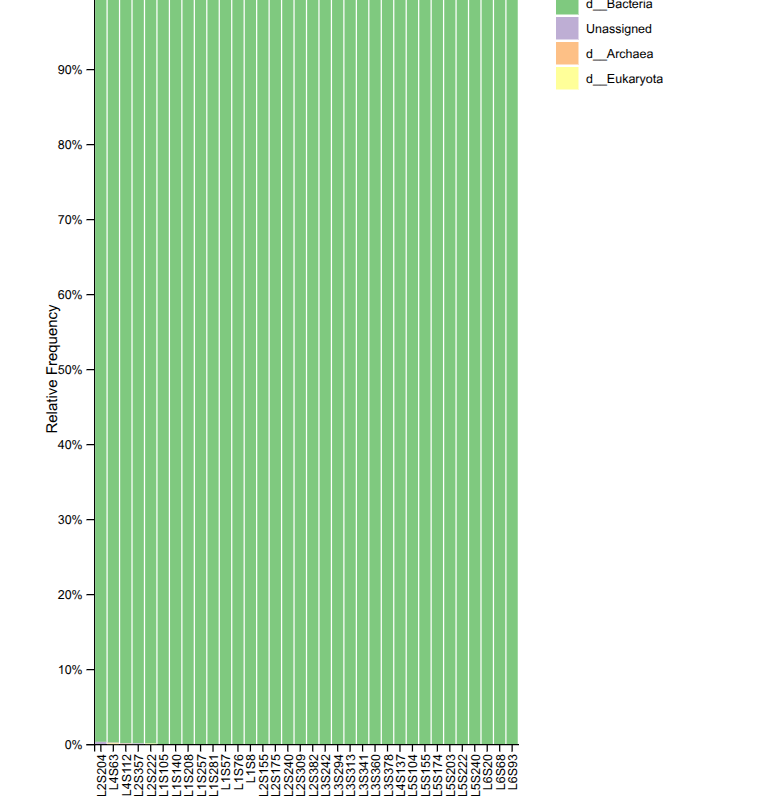
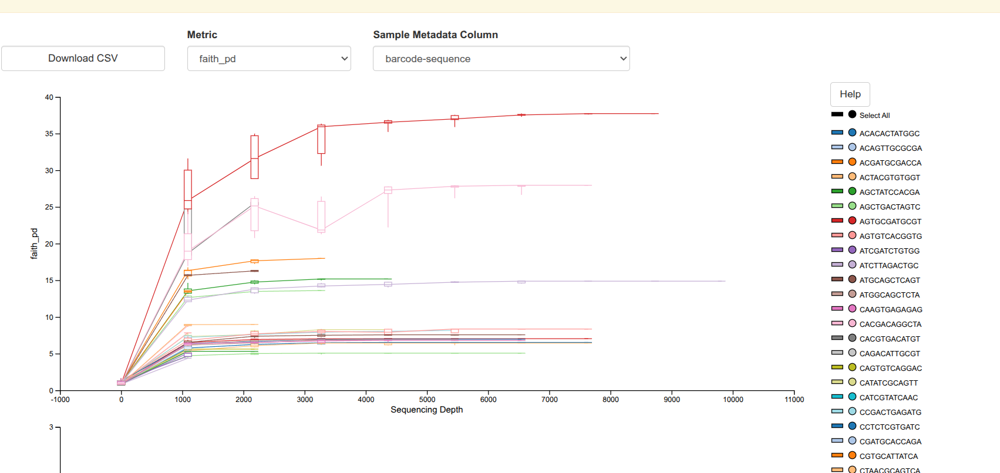
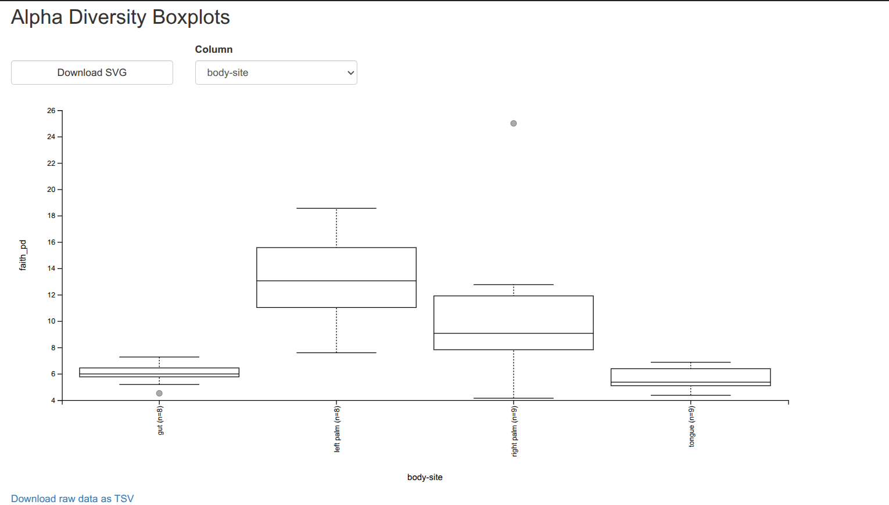
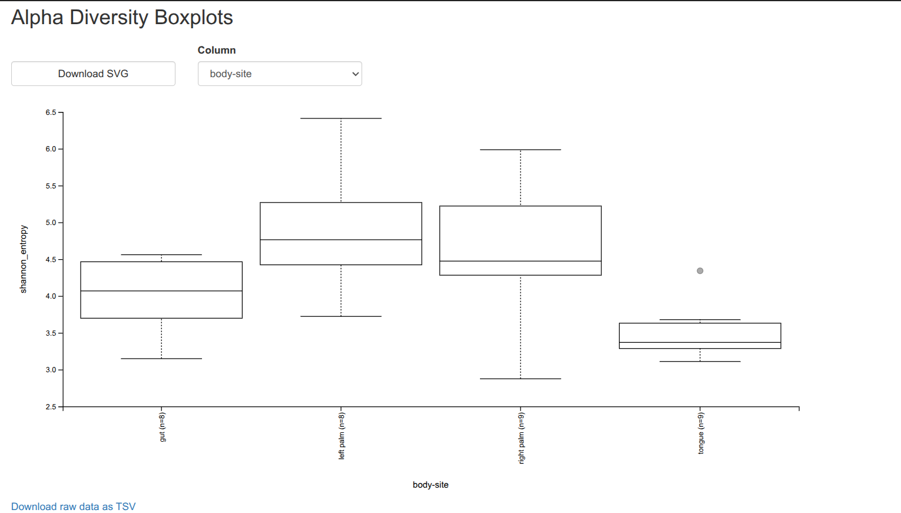
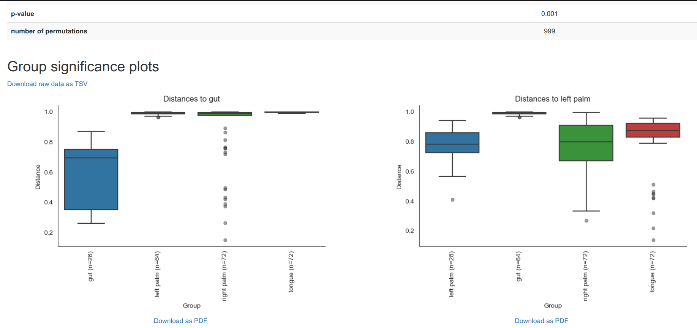
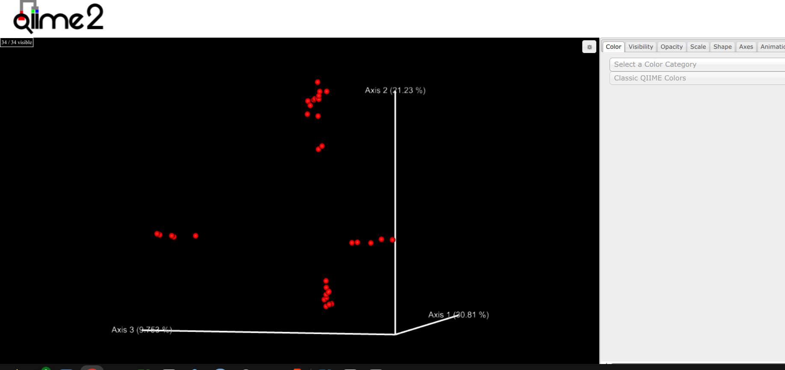
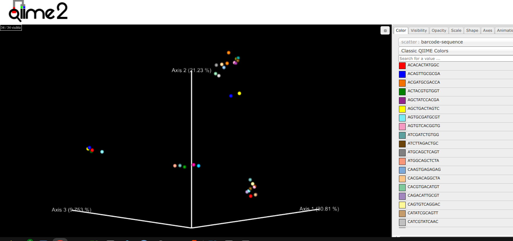
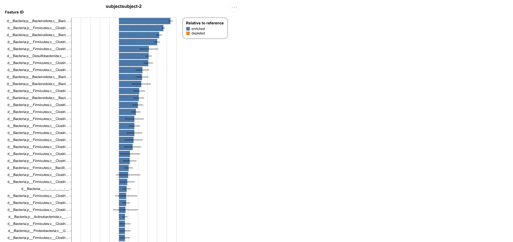

# 16S rRNA amplicon analysis with QIIME 2 — four body sites

**Aim:** process 16S rRNA amplicon data with QIIME 2 — denoise reads into ASVs, assign taxonomy, compare alpha and beta diversity of microbial communities from four body sites (gut, left palm, right palm, tongue), and find taxa that differ in abundance between two subjects in the gut samples.
**Data:** multiplexed single-end reads + barcodes (`sequences.fastq.gz`, `barcodes.fastq.gz`), `sample-metadata.tsv`; 34 samples.
**Tools:** QIIME 2 (2024.10), DADA2, MAFFT + FastTree, SILVA 138 99 % naive-Bayes classifier, ANCOM-BC.

## Procedure
1. **Import and demultiplex** (`scripts/01_import_demux_dada2.sh`): import as `EMPSingleEndSequences`; `qiime demux emp-single` with the barcode column `barcode-sequence`; summarise.
2. **Denoise with DADA2** (same script): `denoise-single --p-trim-left 0 --p-trunc-len 120` → ASV table, representative sequences, denoising stats.
3. **Feature table and phylogeny** (`02_feature_table_phylogeny.sh`): summarise table / sequences; `align-to-tree-mafft-fasttree` → rooted tree.
4. **Taxonomy** (`03_taxonomy_silva.sh`): `classify-sklearn` with the SILVA 138 (99 %) full-length classifier; taxa barplot.
5. **Diversity** (`04_diversity_analysis.sh`): alpha rarefaction (max depth 9,820); `core-metrics-phylogenetic` at sampling depth **897** (keeps all 34 samples); alpha group significance (Faith's PD, Shannon; Kruskal–Wallis); beta group significance (Bray–Curtis, PERMANOVA, pairwise); PCoA in Emperor.
6. **Differential abundance** (`05_ancombc_gut.sh`, `06_significant_genera.py`): keep gut samples; ANCOM-BC with formula `subject` at ASV level and at genus level (taxa collapsed to level 7); export and list taxa with q < 0.05.

## Results
- **Taxonomy:** about 100 % of reads classified as Bacteria; Archaea, Eukaryota and Unassigned are negligible.
- **Rarefaction:** diversity plateaus at roughly 2,000–4,000 reads for most samples; sampling depth 897 retains all 34 samples.
- **Alpha diversity** (medians read from the plots): Faith's PD — left palm ≈ 13, right palm ≈ 9, gut ≈ 6, tongue ≈ 5.4. Shannon — left palm ≈ 4.8, right palm ≈ 4.5, gut ≈ 4.1, tongue ≈ 3.4.
- **Beta diversity:** Bray–Curtis PERMANOVA **p = 0.001** (999 permutations). PCoA axes 1–3 explain 30.81 %, 21.23 % and 9.753 % (≈ 61.8 % total).
- **ANCOM-BC (gut, subject-2 vs subject-1, genus level):** 15 taxa with q < 0.05 — 12 enriched in subject-2, 3 in subject-1.

| LFC | q-value | Direction |
|---|---|---|
| 4.6715 | 2.316e-145 | subject-2 |
| 5.4050 | 1.112e-124 | subject-2 |
| −4.2891 | 5.074e-56 | subject-1 |
| 4.2232 | 2.834e-43 | subject-2 |
| 4.0110 | 1.793e-41 | subject-2 |
| 3.1183 | 1.08e-19 | subject-2 |
| 3.0819 | 4.538e-09 | subject-2 |
| −3.5267 | 0.009319 | subject-1 |
| −1.9611 | 0.01363 | subject-1 |
| 1.7817 | 0.01772 | subject-2 |
| 2.0847 | 0.01917 | subject-2 |
| 2.4211 | 0.02118 | subject-2 |
| 2.4642 | 0.03181 | subject-2 |
| 1.9819 | 0.03474 | subject-2 |
| 2.1263 | 0.04966 | subject-2 |

(The genus column prints only `s__` / empty — these taxa have no species-level name in SILVA.)










## Interpretation


**Fig 1 — taxa barplot (domain).** At the domain level every sample is almost entirely Bacteria (~100 %). Unassigned, Archaea and Eukaryota are negligible slivers. The 16S primers amplified bacterial DNA specifically, with little non-target amplification and almost no unclassified reads, so the data suit bacterial diversity analysis. One domain says nothing about community differences; finer levels are needed.

**Fig 2 — alpha rarefaction.** Faith's PD rises steeply to about 1,000 reads and flattens; most samples plateau by ~2,000–4,000 reads, so diversity is adequately captured. Most samples sit at about 5–15, two are far more diverse (about 38 and 28) and still rise slightly. Lines end at different depths because samples were sequenced to different depths. The boxes at each depth (variation across repeated subsamplings) are very narrow at higher depths, so estimates are stable. The chosen depth of 897 is on the early part of the curves but keeps all 34 samples, and the ranking should hold as most curves are near plateau.

**Fig 3 — Faith's PD by body site.** Left palm is highest (median ~13, IQR ~11–15.5, max ~18.5). Right palm is intermediate and variable (median ~9, whiskers ~4–13) with an outlier of ~25 that matches the highly diverse sample from the rarefaction plot. Gut (median ~6) and tongue (~5.4, lowest) have low diversity and narrow boxes, so individuals are similar. The palms host phylogenetically broader, more individual-specific communities; gut and tongue have a more restricted set of closely related lineages. Left/right palm boxes overlap, as do gut/tongue; palm vs tongue/gut differ clearly. With only 8–9 samples per group the Kruskal–Wallis test is the formal test.

**Fig 4 — Shannon by body site.** Left palm has the highest median (~4.8), then right palm (~4.5, range ~2.9–6.0) and gut (~4.1); tongue is lowest (~3.4, narrow), indicating communities dominated by a few taxa. The gut ranks higher than in Faith's PD: many fairly evenly distributed ASVs that belong to closely related lineages. Differences are smaller and boxes overlap more than for Faith's PD, so evidence for site differences is weaker, except for the consistently lower tongue.

**Fig 5 — Bray–Curtis PERMANOVA.** p = 0.001 with 999 permutations (the smallest attainable), so community composition differs significantly among body sites. Gut-to-gut distances (median ~0.7) are clearly smaller than gut to left palm, right palm or tongue (all ~1.0, almost no shared ASVs). Left palm samples are closest to each other (~0.78) and to right palm (~0.8, wide range), ~1.0 from gut and ~0.87 from tongue — the two palms resemble each other more than gut or tongue, as expected for similar skin habitats. Within-group distances are smaller than between-group, the pattern a significant PERMANOVA reflects.

**Fig 6 — PCoA (Emperor).** Axes 1–3 explain 30.81 %, 21.23 %, 9.753 % (~61.8 %), so the ordination captures most community differences. The 34 samples form several compact, well-separated clusters rather than one cloud, consistent with the large between-group distances in Fig 5.

**Fig 7 — PCoA coloured by barcode.** Each point has its own colour because the barcode is unique per sample, so colours identify samples, not sites. The same clusters appear, each containing a mix of colours. The clustering agrees with the significant PERMANOVA; colouring by body site would show which cluster is which site.

**Fig 8 — ANCOM-BC barplot.** Log fold change of each significant taxon in subject-2 vs reference subject-1, ordered by LFC, with standard-error lines. All bars in this upper part are blue (enriched in subject-2); mostly Firmicutes (Clostridia) and Bacteroidota (Bacteroidia), with single taxa from Desulfobacterota, Actinobacteriota and Proteobacteria and one only classified as Bacteria. Largest effects ≈ 5 LFC units; long error bars mean less precise estimates. With only two subjects, differences reflect inter-individual variation, not a treatment effect.

**Genus-level ANCOM-BC table.** Of 15 taxa with q < 0.05, 12 are enriched in subject-2 (LFC 1.78 to 5.41) and 3 in subject-1 (LFC −1.96, −3.53, −4.29). The two most significant (q = 2.3e-145 and 1.1e-124) have large positive LFC; the strongest subject-1 taxon (LFC −4.29, q = 5.1e-56) is also highly significant; the rest have q between 0.009 and 0.05. The genus column shows only `s__` because these taxa have no species-level name in SILVA, so exact identity cannot be given from the output; Fig 8 suggests mainly Clostridia and Bacteroidia. The two subjects have clearly different gut communities, with subject-2 enriched in more taxa.

**Conclusion.** Reads were almost exclusively bacterial; rarefaction showed sufficient depth for most samples; alpha diversity was highest in palms and lowest in tongue (Shannon) and tongue and gut (Faith's PD); the PERMANOVA (p = 0.001) with the PCoA clusters showed distinct communities per body site; ANCOM-BC found 15 taxa differing between the gut microbiota of the two subjects.

## Files
```
scripts/   01_import_demux_dada2.sh  02_feature_table_phylogeny.sh  03_taxonomy_silva.sh
           04_diversity_analysis.sh  05_ancombc_gut.sh  06_significant_genera.py
results/   fig01–fig08 (.png)
reports/   Debarshi_Das_Adhkary_255hsbb011_16S_rRNA_QIIME2-1.pdf
```
