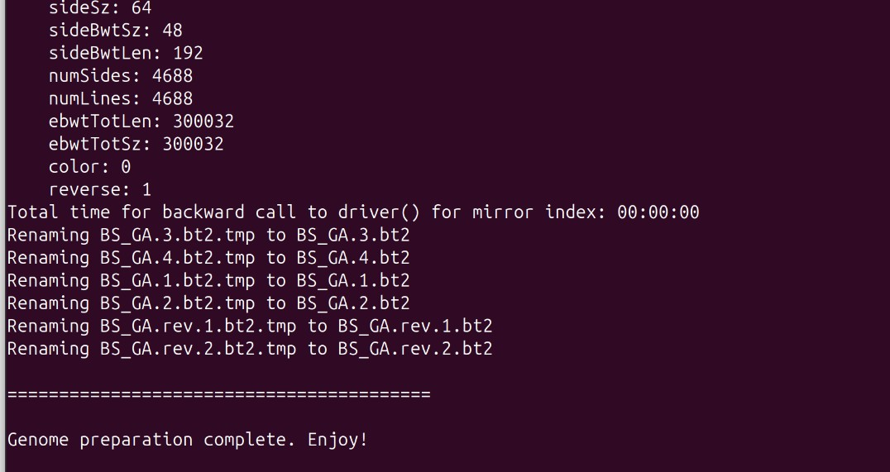
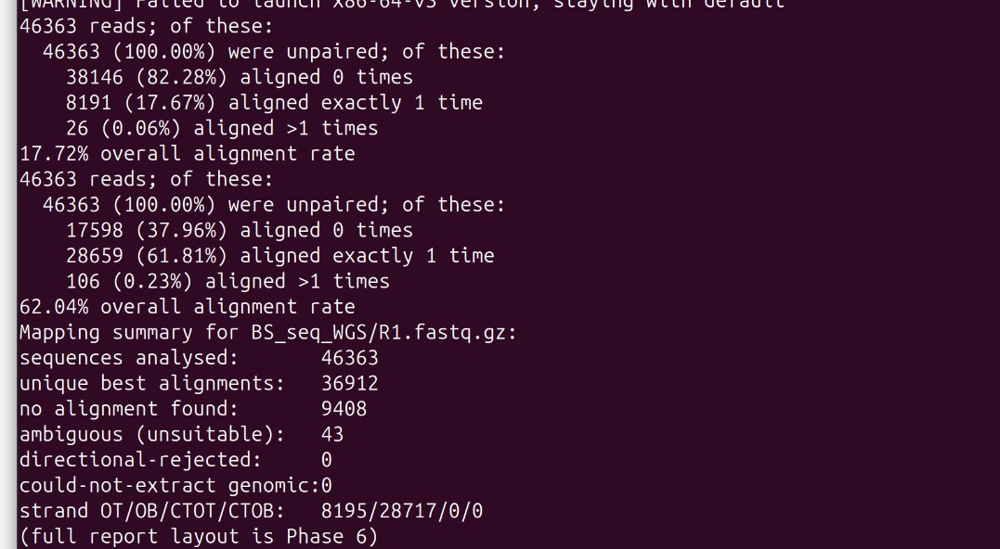
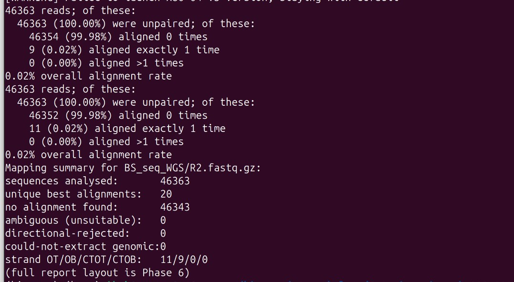
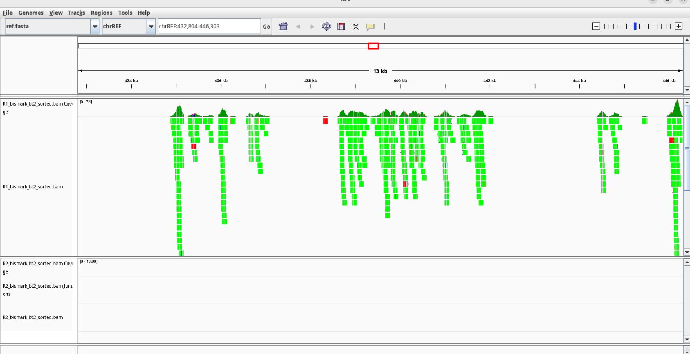
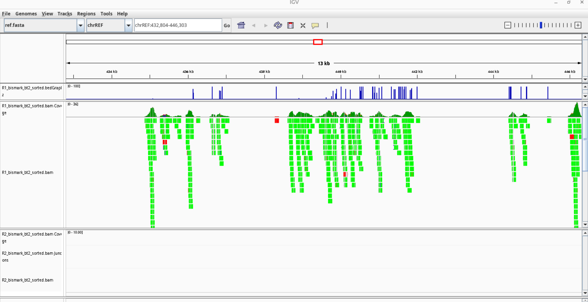
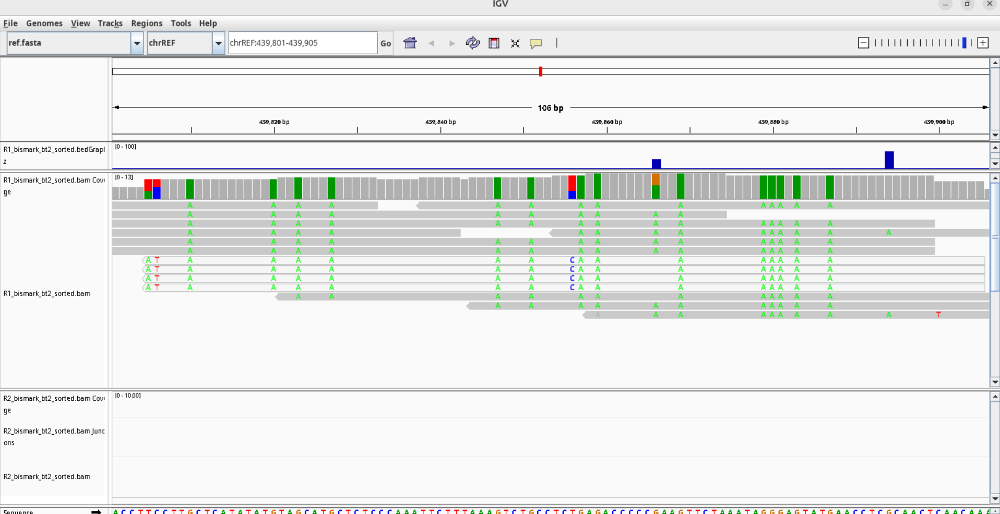

# Whole-genome bisulfite sequencing with Bismark

**Aim:** analyse WGBS data with the Bismark pipeline — prepare the bisulfite-converted reference, align reads, sort/index BAMs, extract cytosine methylation in CpG, CHG and CHH contexts, produce bedGraph tracks, and check positional bias (M-bias) and IGV profiles.
**Data:** reads `R1.fastq.gz` and `R2.fastq.gz` (46,363 sequences each) and a reference `ref.fa`.
**Tools:** Bismark, Bowtie2, samtools, IGV.

## Procedure (`scripts/01_bismark_alignment_extraction.sh`)
1. **Genome preparation:** `bismark_genome_preparation BS_seq_WGS/` — in-silico C→T / G→A conversion and Bowtie2 indexes.
2. **Alignment:** `bismark --bowtie2` on R1 and R2 separately → `R1_bismark_bt2.bam`, `R2_bismark_bt2.bam` + alignment reports.
3. **Sort and index** with samtools.
4. **Methylation extraction:** `bismark_methylation_extractor --bedGraph --counts` → context-specific calls, bedGraph/coverage files, M-bias report.
5. **IGV:** load reference, sorted BAMs and bedGraph files.
6. **M-bias:** inspect `R1_bismark_bt2_sorted.M-bias.txt` (CpG, first 17 read positions).

## Results
**Alignment (Bismark):**

| | R1 | R2 |
|---|---|---|
| Sequences analysed | 46,363 | 46,363 |
| Unique best alignments | 36,912 | 20 |
| Mapping efficiency | 79.6 % | 0.0 % |
| No alignment | 9,408 | 46,343 |
| Not unique | 43 | 0 |
| Strand (CT/CT : CT/GA) | 8,195 : 28,717 | 11 : 9 |

**Cytosine methylation:**

| | R1 | R2 |
|---|---|---|
| C's analysed | 875,967 | 485 |
| Methylated C in CpG / CHG / CHH | 29,030 / 851 / 2,211 | 10 / 8 / 282 |
| Unmethylated C in CpG / CHG / CHH | 17,594 / 222,073 / 604,208 | 2 / 40 / 143 |
| % methylated CpG | 62.3 % | 83.3 % |
| % methylated CHG | 0.4 % | 16.7 % |
| % methylated CHH | 0.4 % | 66.4 % |

(R2's percentages rest on only 485 cytosines, from 20 aligned reads.)

**M-bias, CpG, R1, positions 1–17:** % methylation between 58.80 % (position 8, 254 methylated / 178 unmethylated) and 73.70 % (position 2, 239 / 85); coverage 327–513 per position.








## Interpretation
Written in the report.

**IGV, broad region (Figure 1).** Blue vertical spikes (bedGraph track) mark positions where Bismark called cytosine methylation; spike height is the methylation percentage, flat/empty regions mean no signal or no reported methylation. Green coverage peaks (BAM track) are read pile-ups; greater height = higher read depth.

**IGV, base-pair resolution (Figure 2).** The zoomed 106-bp interval shows individual R1 reads aligned to the reference; most bases match, with a few mismatches such as C-to-T changes. C-to-T differences usually come from unmethylated cytosines converted to uracil (read as T) during bisulfite treatment, but a mismatch must be classified using Bismark's context and strand calls before it counts as methylated or unmethylated. R1 shows clear local coverage across the interval while R2 shows no reads, i.e. R2 lacks coverage at this locus.

**M-bias.** Methylation across the first 17 positions ranges from 58.80 % (position 8) to 73.70 % (position 2). There is no obvious systematic upward or downward trend, so severe technical bias is not immediately apparent. The full read length, particularly the extreme 5′ and 3′ ends, must still be examined to decide whether end-trimming of biased cycles is needed before final quantification.

**Conclusion.** R1 and R2 were aligned independently to the converted genome, then sorted and indexed. Bismark extracted cytosine-level calls and bedGraph tracks, allowing visual confirmation of read depth and methylation density in IGV. CpG sites were substantially methylated compared with CHG and CHH. The M-bias check confirmed consistency across the early sequencing cycles, completing the QC and mapping pipeline.

## Files
```
scripts/   01_bismark_alignment_extraction.sh
results/   fig01–fig06 (.png)
reports/   Debarshi_011_bismark.pdf
```
