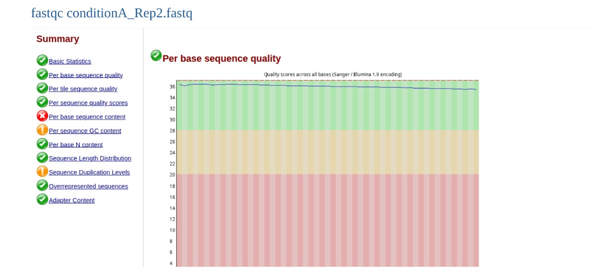
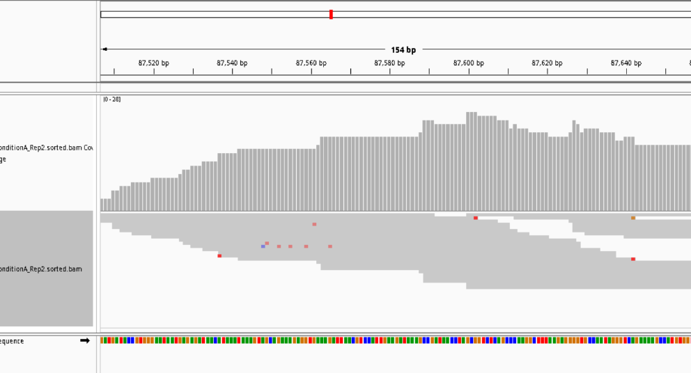
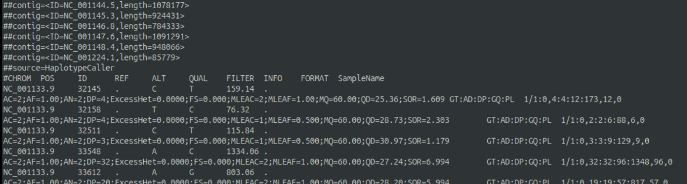
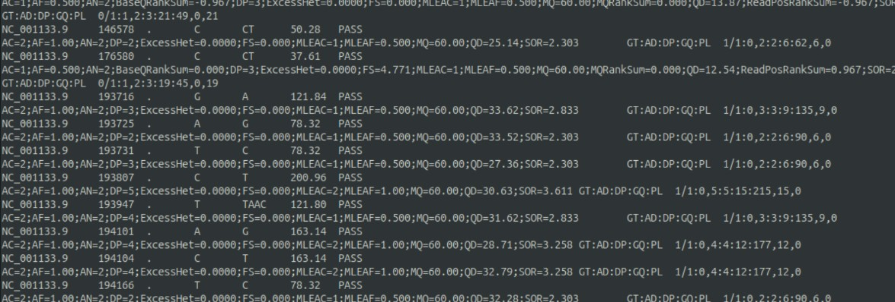
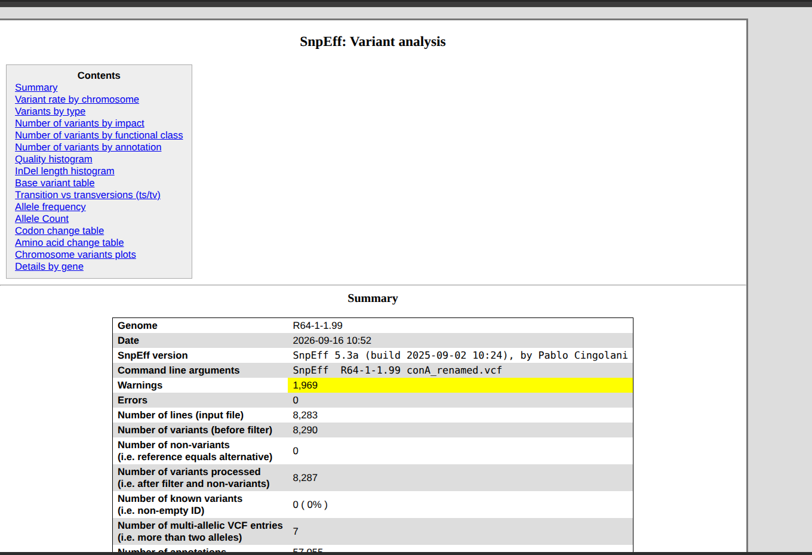
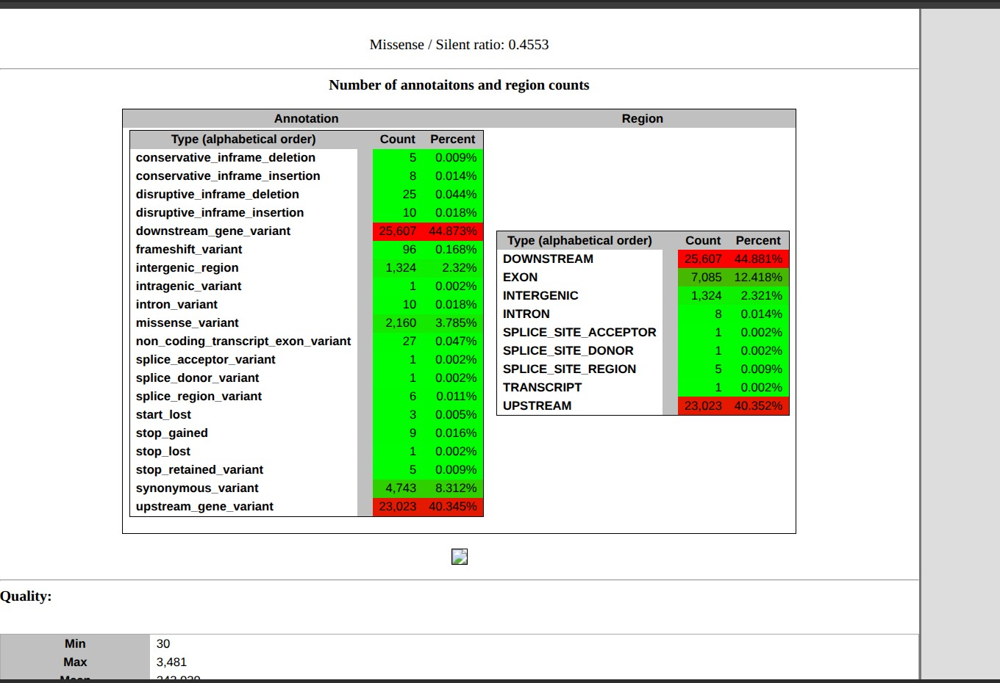
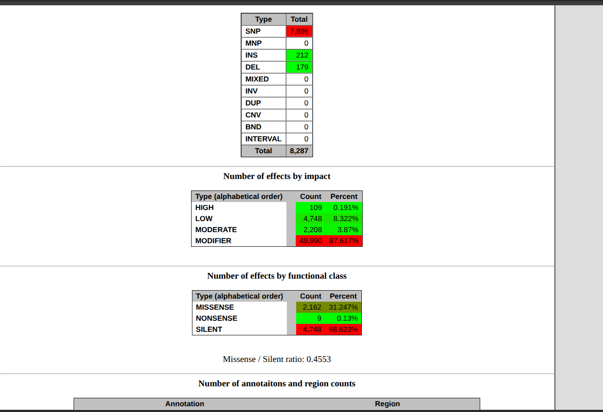

# Variant calling with BWA + GATK and annotation with SnpEff — yeast

**Aim:** call SNPs and small indels from single-end reads of yeast sample `conditionA_Rep2` against the *S. cerevisiae* R64 reference, filter them, and predict their functional impact.
**Data:** `conditionA_Rep2.fastq`; `GCF_000146045.2_R64_genomic.fa`.
**Tools:** FastQC, BWA-MEM, samtools, Picard, GATK (HaplotypeCaller, BaseRecalibrator, ApplyBQSR, VariantFiltration), bcftools, SnpEff (database `R64-1-1.99`), IGV.

## Procedure
1. **QC + alignment** (`scripts/01_align_bwa_samtools.sh`): FastQC → `bwa index` → `bwa mem` with a read group (`@RG ID, SM, PL, LB`) → SAM→BAM → sort → index.
2. **GATK preparation and calling** (`scripts/02_gatk_variant_calling.sh`): sequence dictionary + FASTA index → Picard `MarkDuplicates` → draft `HaplotypeCaller` → `BaseRecalibrator` (known sites = the draft VCF, as done in the practical) → `ApplyBQSR` → final `HaplotypeCaller` → `VariantFiltration` hard filters: QD < 10, FS > 60, MQ < 40, MQRankSum < −12.5.
3. **Annotation** (`scripts/03_snpeff_annotation.sh`): check SnpEff database names, check VCF chromosome names, rename NCBI accessions with `bcftools annotate --rename-chrs`, run `snpEff -stats`.

## Results
SnpEff summary of the annotated VCF:

| Metric | Value |
|---|---|
| Variants | 8,805 |
| SNPs / insertions / deletions | 8,309 / 273 / 223 |
| Mean spacing (12.16 Mb genome) | ~1 variant per 1.38 kb |
| Most variants | Chromosome XIII (1,278) |
| Fewest variants | mitochondrial genome (5) |
| Highest density | Chromosome V |
| Impact | 87.6 % MODIFIER, 8.1 % LOW, 175 HIGH (~0.3 %) |
| Coding effects | 67.6 % silent, 2,344 missense, 15 nonsense |









## Interpretation
Written in the report.

**IGV before variant calling.** Good read coverage across the selected region, reads aligned continuously to the reference, and a few mismatching bases. These mismatches are potential variant sites that HaplotypeCaller evaluates and reports in the VCF.

**SnpEff summary.**
- *Variant count and types:* 8,805 variants, dominated by SNPs (8,309) plus 273 insertions and 223 deletions — about one variant every ~1.38 kb across the 12.16 Mb genome.
- *Distribution:* chromosome XIII had the most variants (1,278), the mitochondrial genome the fewest (5); chromosome V showed the highest density.
- *Functional impact:* most variants are non-coding or mild — 87.6 % MODIFIER, 8.1 % LOW; only 175 (~0.3 %) are predicted HIGH impact (likely to disrupt gene function).
- *Coding effects:* about two-thirds (67.6 %) are silent/synonymous; 2,344 missense and just 15 nonsense mutations.
- *Key takeaway:* most detected variants are benign or non-disruptive. For downstream analysis, prioritise the 175 HIGH-impact and 2,344 missense variants, while double-checking the ~2,100 annotation warnings.

## Files
```
scripts/   01_align_bwa_samtools.sh  02_gatk_variant_calling.sh  03_snpeff_annotation.sh
results/   fig01–fig07 (.png)
reports/   Debarshi_011_Variant_call.pdf
```
