# Functional annotation (SnpEff), pileup calling (VarScan) and microbial resequencing (breseq)

**Objective:** annotate the yeast variants from the GATK workflow with SnpEff, benchmark an alternative caller (VarScan on a samtools pileup), and detect mutations and structural rearrangements in a bacterial dataset with breseq.
**Data:** `conA_variants_final.vcf` and `conditionA_Rep2.sorted.bam` (yeast, from project 09); *E. coli* run SRR12340679 with reference U00096 (GenBank).
**Tools:** bcftools, SnpEff 5.2 (database R64-1-1.99), samtools, VarScan, breseq, SRA Toolkit.

## Procedure
1. **SnpEff** (`scripts/01_snpeff_annotation.sh`): inspect the VCF → install SnpEff → fetch `R64-1-1.99` → find that the database uses Roman-numeral chromosomes (I, II, …, Mito) while the VCF uses NCBI accessions (NC_001133.9, …) → write `chr_map.txt` and rename with `bcftools annotate --rename-chrs` → annotate → confirm the `ANN` field → check `ERROR_CHROMOSOME_NOT_FOUND` count (expected 0) → extract a table with `bcftools query` → pull out `HIGH` impact and `missense_variant` rows.
2. **VarScan** (`scripts/02_varscan_pileup_calling.sh`): `samtools faidx` → `samtools mpileup` → `varscan pileup2snp` / `pileup2indel` → filters `--min-var-freq 0.20` and `--p-value 0.1`.
3. **breseq** (`scripts/03_breseq_resequencing.sh`): `prefetch` + `fasterq-dump` to get SRR12340679 → `breseq -j 4 -r genomic.gbff reads_1 reads_2` → inspect `index.html` and `output.gd`.

## Results
**SnpEff example record** (chromosome I, position 32145, C→T): gene GDH3 (YAL062W), `c.579C>T`, `p.Ala193Ala`, `synonymous_variant`, LOW impact. The same record also carries upstream/downstream annotations for neighbouring genes (FLO9, BDH2, BDH1, ECM1, YAL059C-A) as MODIFIER.

**VarScan:** the report shows the terminal summaries of `pileup2snp` / `pileup2indel` runs with the two filters (figures below); no further numbers are given in the text.

**breseq (E. coli, SRR12340679):**
- Run time 1 h 11 min 58 s with Bowtie2 v2.5.5 and R v4.5.2 (alignment, junction identification and evidence examination < 5 min combined; ~58 min for output generation and mutation prediction).
- Genome-wide coverage ≈ 50×, with a sharp spike of nearly 1,500× near 3.75 Mb.
- Coverage of unique positions fits a negative binomial with mean ≈ 55 reads; the tail at 100–140× holds multi-copy regions.
- Read-alignment (RA) evidence: an intergenic homopolymer contraction (T)₉→8 at position 310 plus a dense cluster of SNPs in `thrA` (synonymous, e.g. R19R, G84G, T146T).
- New-junction evidence: IS1 (position 3,583,428) and IS150 (position 3,721,927, 872 supporting reads); junction frequencies range from fixed to subclonal (24.0 % – 64.3 %); examples ygcE/queE and lysQ/nadA.
- Probability of no read start at a position/strand (skew): 0.93658 for contig U00096.

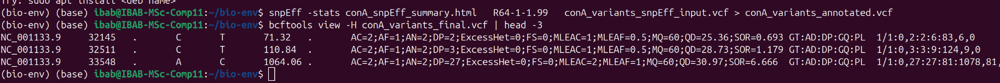
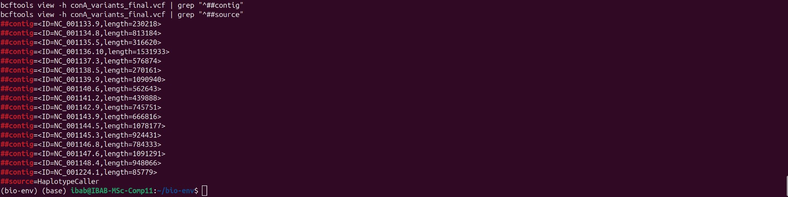
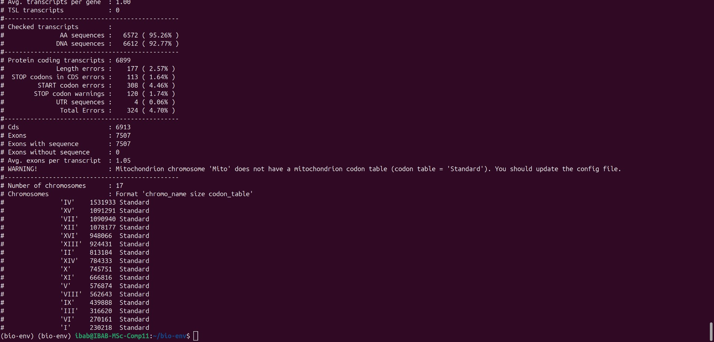
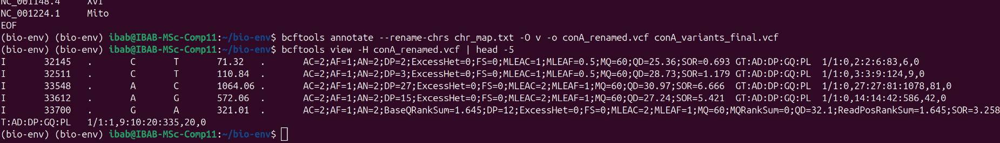
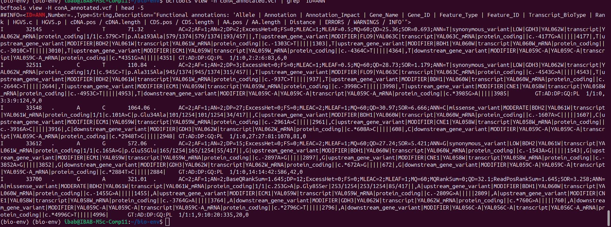
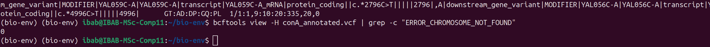
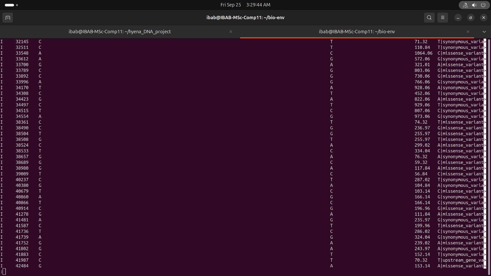
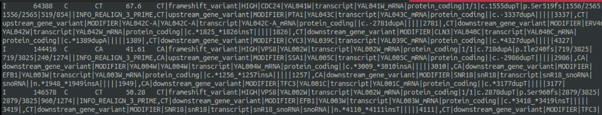
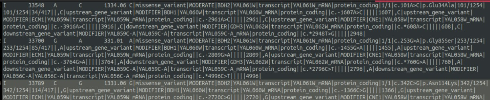

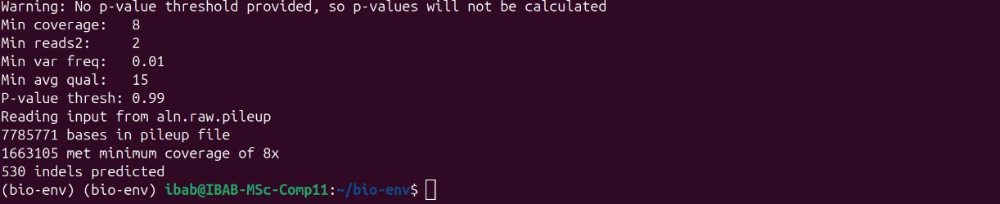

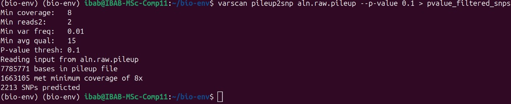
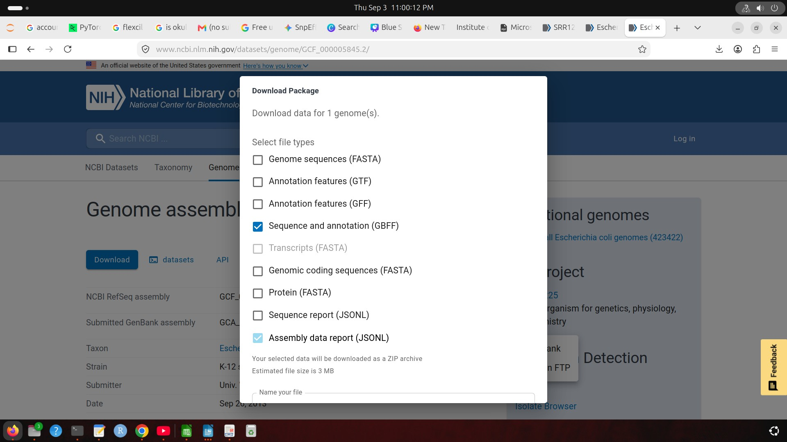
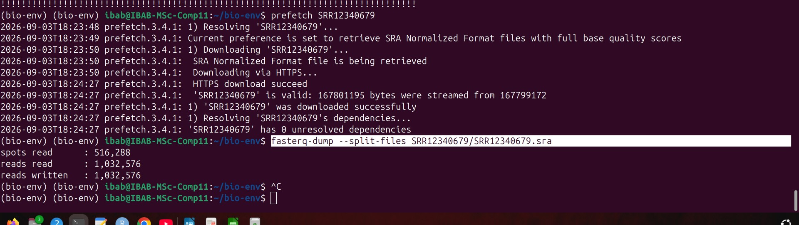
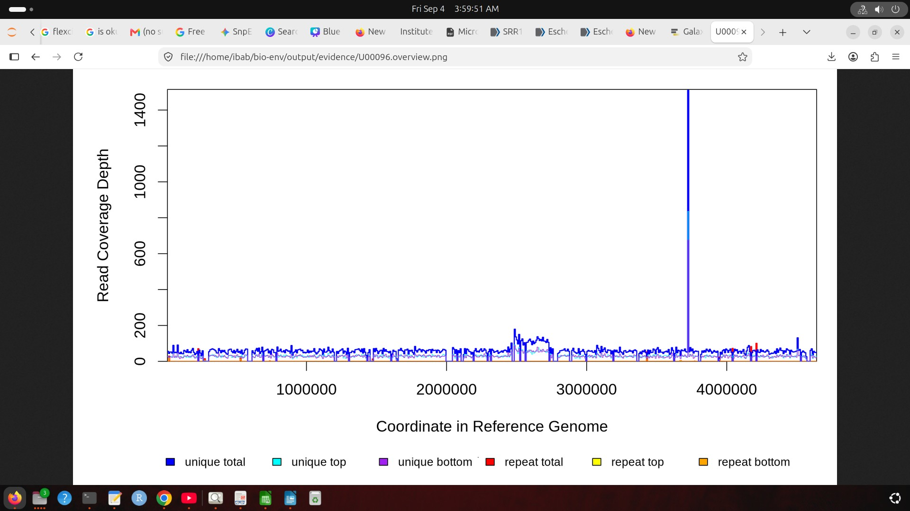
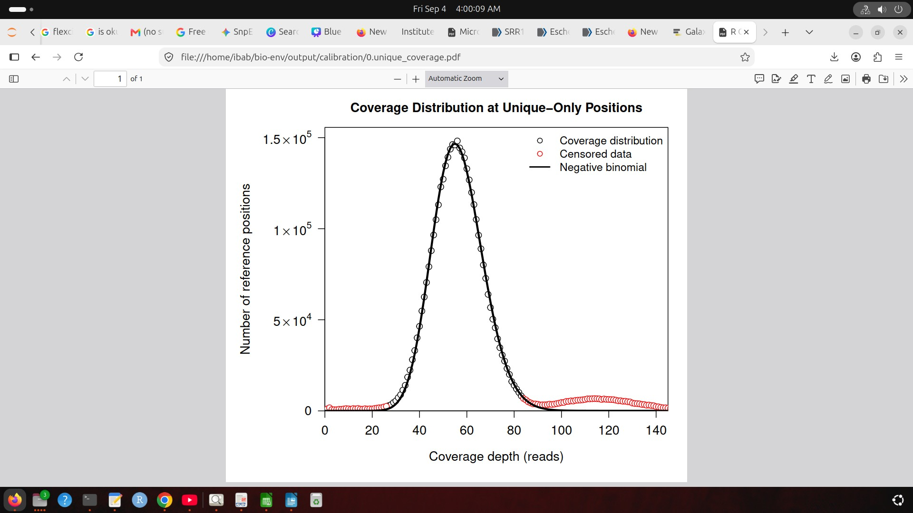
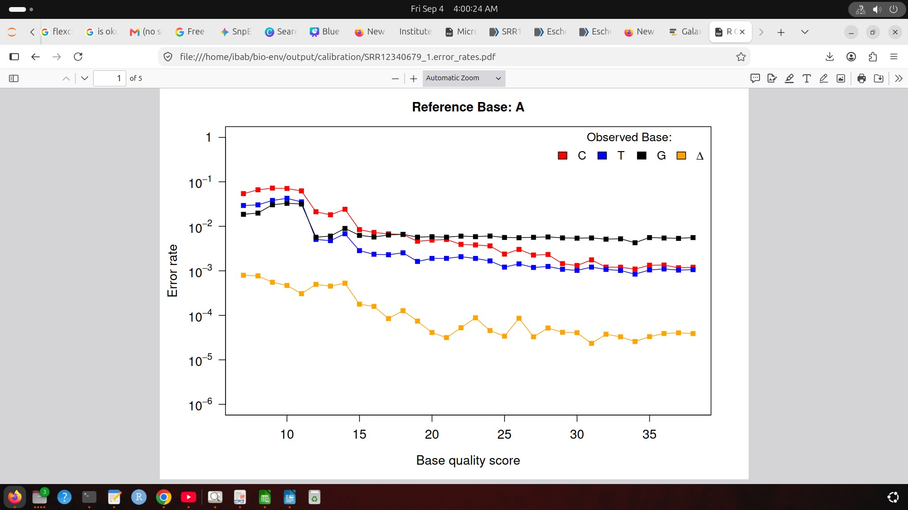
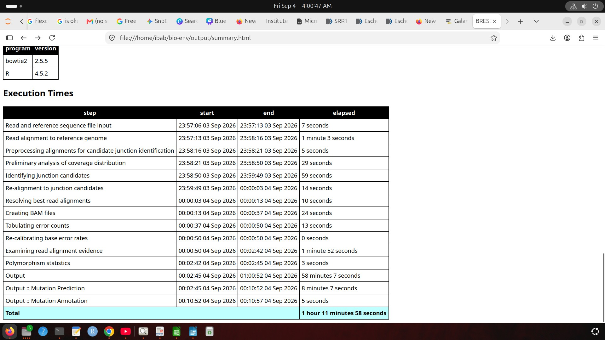
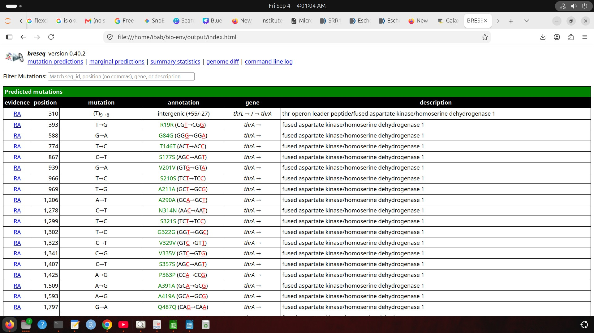
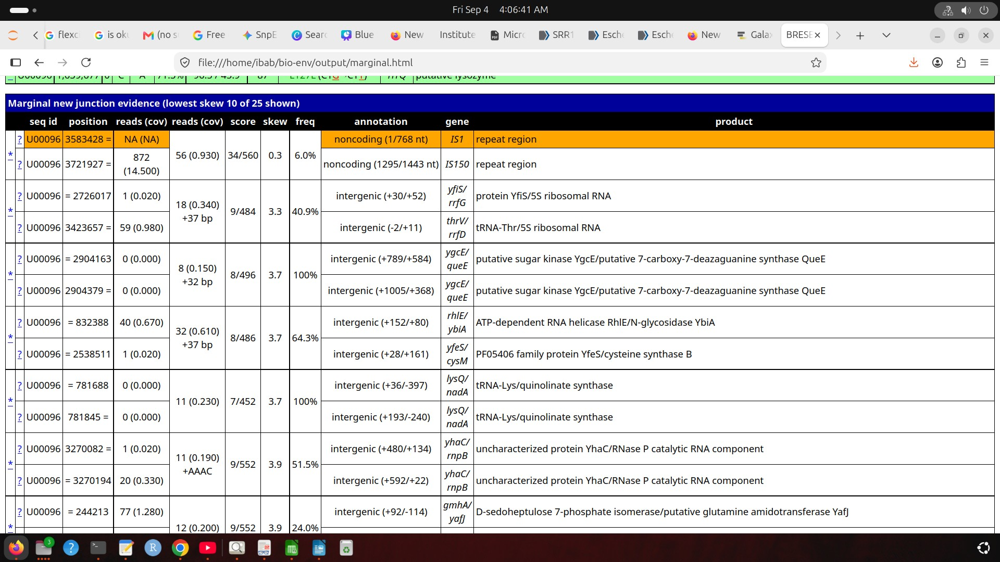
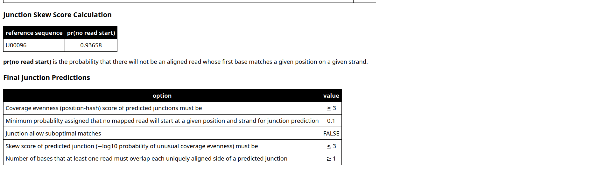

## Interpretation
**SnpEff variant at chr I:32145.** Coding change `c.579C>T` → `p.Ala193Ala` in GDH3 (YAL062W), a synonymous variant of LOW impact; alanine is retained, so the mutation is functionally neutral and does not disrupt enzyme performance.

**High-priority candidates.** Frameshift indels in coding regions shift the triplet reading frame and typically cause premature stop codons and truncated proteins (examples named: CDC24 and VPS8). Missense variants change a single amino acid (e.g. p.Glu34Ala in BDH2) and can affect active sites, secondary structure or protein stability.

**VarScan filters.** `--min-var-freq 0.20` discards spurious alignment errors and low-level PCR errors, keeping variants supported by at least one-fifth of the covering reads. `--p-value 0.1` (Fisher's exact test) retains calls with p-values well below the ceiling, giving statistical confidence that they are real.

**breseq — student's notes.** breseq is used only for variant calling in haploid genomes such as bacteria; if the genome contains transposons it can also identify those mutations. A GenBank file is needed (not FASTA) because FASTA has no annotation. Open question the student recorded: why 40× depth for clonal and 120× for population samples? For polymorphic (mixed) samples use `breseq -p`.

**breseq — report figures.**
- *Coverage:* genome-wide read coverage across the *E. coli* chromosome is largely uniform at about 50×. The sharp spike to nearly 1,500× near 3.75 Mb indicates a high-copy-number duplication, tandem amplification or repeat-element expansion.
- *Coverage distribution:* depth over unique positions follows the fitted negative binomial model (mean ≈ 55); censored points in the right tail (100–140×) are duplicated or multi-copy regions deviating from the single-copy baseline. This gives breseq a calibrated baseline to tell true deletions and copy-number changes from random variation.
- *Error rates:* for reference base A, observed mismatch frequencies decline steadily from Q10 to Q38, transitions (A→G) are the most prevalent substitution error, and indels stay below 10⁻⁴. This lets breseq separate real low-frequency mutations from sequencing artefacts using quality scores.
- *Run time:* most of the time went to final output generation and mutation prediction (~58 min), reflecting the load of resolving complex genomic evidence across the dataset.
- *RA evidence:* all `thrA` alterations are synonymous substitutions, so they reflect divergence from the reference without changing the polypeptide.
- *New-junction evidence:* the candidate breakpoints are characteristic of mobile-element activity and structural rearrangements (IS1, IS150); calls range from fixed junctions (e.g. ygcE/queE, lysQ/nadA) to subclonal/polymorphic ones (24.0 % – 64.3 %). These split-read alignments resolve genomic reorganisations that standard reference-alignment pipelines routinely miss.
- *Skew score and filters:* the probability of observing no read start at a position and strand is 0.93658 for contig U00096. To separate true breakpoints from alignment artefacts, breseq applies thresholds on junction coverage and requires at least 1 overlapping base on each uniquely aligned flank, so only junctions with balanced, high-confidence split-read support are kept.

## Notes
- In the report, the printed annotation line for chr I:32145 shows QUAL 71.32, while the "detailed breakdown" text quotes QUAL 159.14. Both are as written in the source.

## Files
```
scripts/   01_snpeff_annotation.sh  02_varscan_pileup_calling.sh  03_breseq_resequencing.sh
results/   fig01–fig22 (.png)
reports/   Debarshi_011_Functional Annotation.pdf
```
