# De novo bacterial genome assembly (Velvet): baseline pipeline, k-mer size and sequencing depth

Three linked experiments on the same bacterial paired-end Illumina dataset (`SR1`, `SR2`), run with Pixi-managed tools: FastQC, Velvet, QUAST, RagTag, AUGUSTUS, gffread, BUSCO (`bacteria_odb12`), seqtk, BLAST.

| | Experiment | Question | Scripts | Figures |
|---|---|---|---|---|
| A | Baseline assembly + annotation (20/08/2026) | Assemble, scaffold, annotate and identify the organism | `scripts/a_baseline_assembly/` | `results/a_baseline_assembly/` |
| B | k-mer size (23/08/2026) | How do k = 21, 31, 41 change contiguity and gene completeness? (1 M read pairs, 150 bp, NovaSeq 6000) | `scripts/b_kmer_experiment/` | `results/b_kmer_experiment/` |
| C | Sequencing depth (26/08/2026) | Do 3 M, 5 M, 10 M read pairs change the assembly at k = 31? | `scripts/c_depth_experiment/` | `results/c_depth_experiment/` |

---
## A. Baseline assembly, scaffolding and annotation
**Aim:** build a de novo assembly from paired-end reads, refine it by reference-guided scaffolding, assess quality and gene completeness, predict genes ab initio and identify the source organism by remote BLAST.

### Procedure
1. Install tools: `pixi add … velvet quast augustus gffread ragtag busco seqtk` and run FastQC on `SR1.fastq`, `SR2.fastq` (`01_setup_and_fastqc.sh`).
2. Velvet: `velveth Assembly_step1 31 -shortPaired -fastq -separate …`, then `velvetg -cov_cutoff 5 -unused_reads yes`; count contigs with `grep -c ">"`; QUAST on `contigs.fa` (`02_velvet_assembly_and_quast.sh`).
3. RagTag `correct` and `scaffold` against reference GCA_014131755.1; QUAST on the scaffolds (`03_ragtag_scaffolding.sh`).
4. AUGUSTUS (`--species=E_coli_K12`), gene sequences with `gffread -w`, BUSCO `-l bacteria_odb12` on the scaffolds, BLAST of one extracted sequence at NCBI (`04_gene_prediction_and_busco.sh`).

### Results
- Read quality: mean Phred > 32 along the reads; no adapter contamination or tile-level anomalies.
- Draft assembly: **1,688 contigs**.
- BUSCO (scaffolds): **Complete 90.5 %, Fragmented 5.2 %, Missing 1.7 %**.
- BLAST identification: ***Bacteroides thetaiotaomicron*, 100.00 % identity**.

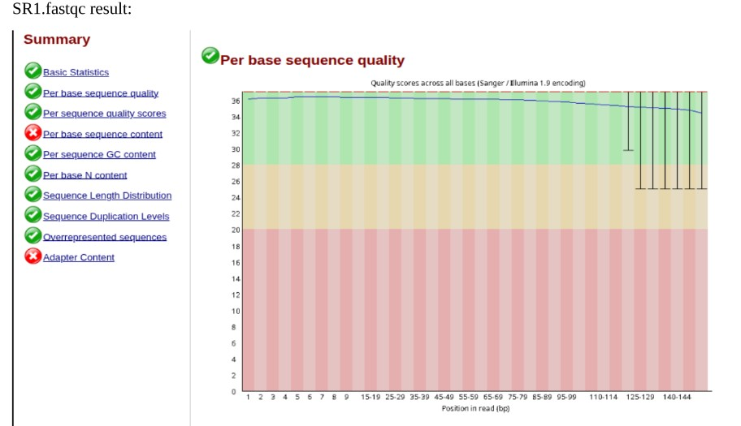
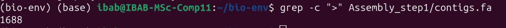
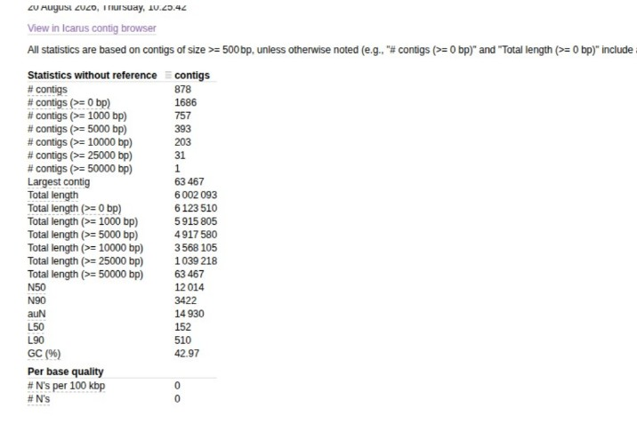
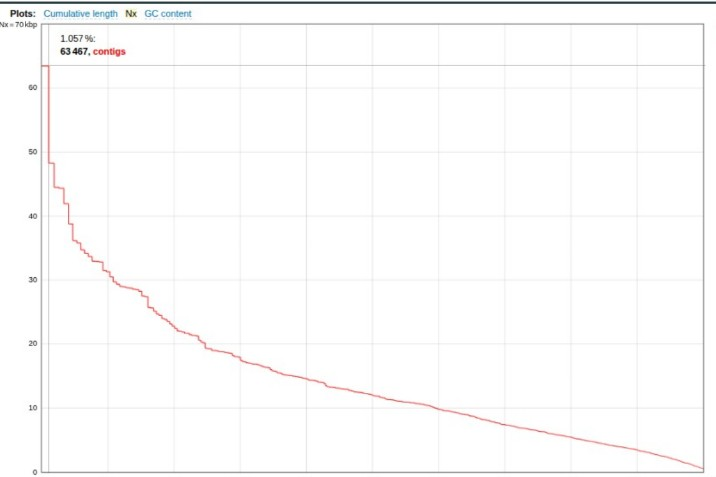
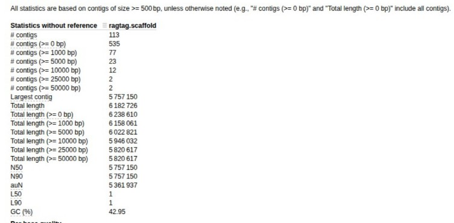
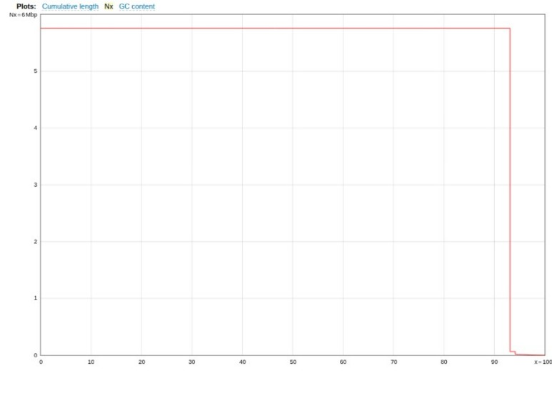
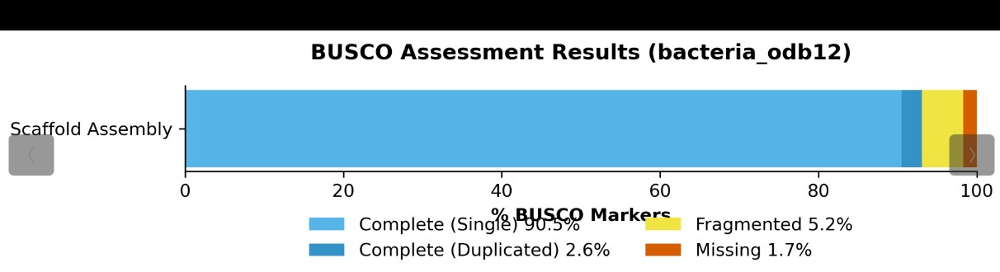
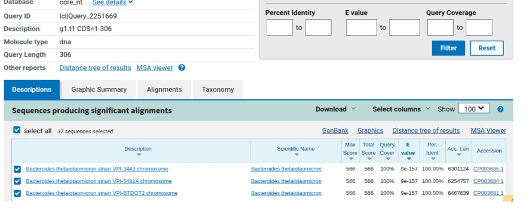

### Interpretation
RagTag can determine contig order and orientation from alignment to the reference. The high share of complete single-copy genes (90.5 %) together with minimal fragmentation indicates a complete assembly with high structural integrity. (The source gives no further commentary for this experiment.)

---
## B. Effect of k-mer size (k = 21, 31, 41)
**Aim:** evaluate how k-mer size changes contiguity, assembly metrics and gene completeness using 1 million paired-end reads (`SR1_1M.fastq`, `SR2_1M.fastq`).

### Procedure
1. FastQC on the reads (`01_fastqc.sh`). Result: Q > 32 (> 99.9 % base accuracy), no adapter contamination or tile anomalies.
2. Velvet for each k with `-cov_cutoff 5 -unused_reads yes` → `Assembly_k21/`, `Assembly_k31/`, `Assembly_k41/` (`02_velvet_kmer_sweep.sh`).
   *Problem recorded:* ultra-short reads (< 500 bp) produced many low-coverage graph nodes and memory errors during index parsing. *Fix:* filter contigs ≥ 500 bp with `seqtk` after assembly before the downstream evaluation.
3. QUAST on the three `contigs.fa` files together; BUSCO (`bacteria_odb12`) on each (`03_quast_and_busco.sh`).

### Results
| k | N50 (bp) | N90 (bp) | L50 | L90 | BUSCO complete | Fragmented | Missing |
|---|---|---|---|---|---|---|---|
| 21 | 4,398 | 1,416 | 402 | 1,297 | 84.5 % (82.8 % S + 1.7 % D) | 12.9 % (15 genes) | 2.6 % (3) |
| 31 | 12,014 | 3,422 | 152 | 510 | 93.1 % (90.5 % S + 2.6 % D) | 5.2 % (6) | 1.7 % (2) |
| 41 | 19,365 | 5,455 | 92 | 305 | 96.6 % (94.0 % S + 2.6 % D) | 2.6 % (3) | 0.9 % (1) |

Total assembly length stayed ~6.0–6.1 Mb and GC ~43 % in all runs; the largest contig at k = 41 is 95,763 bp.

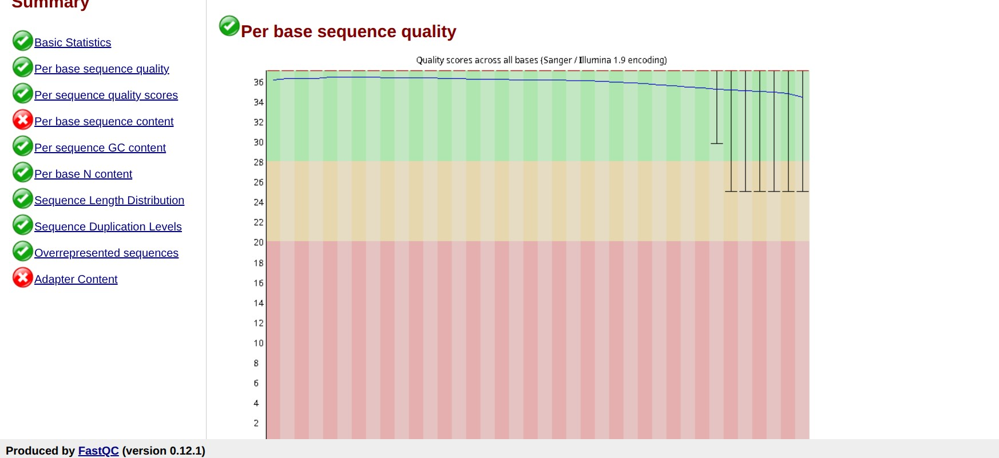
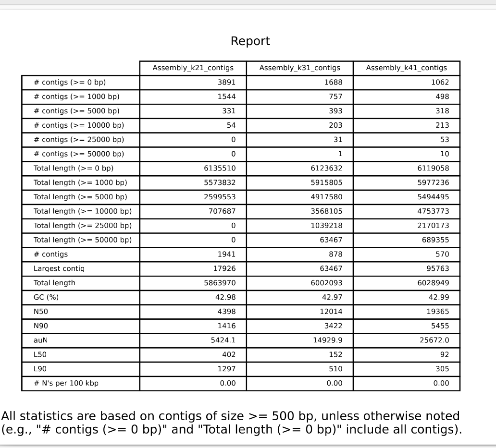
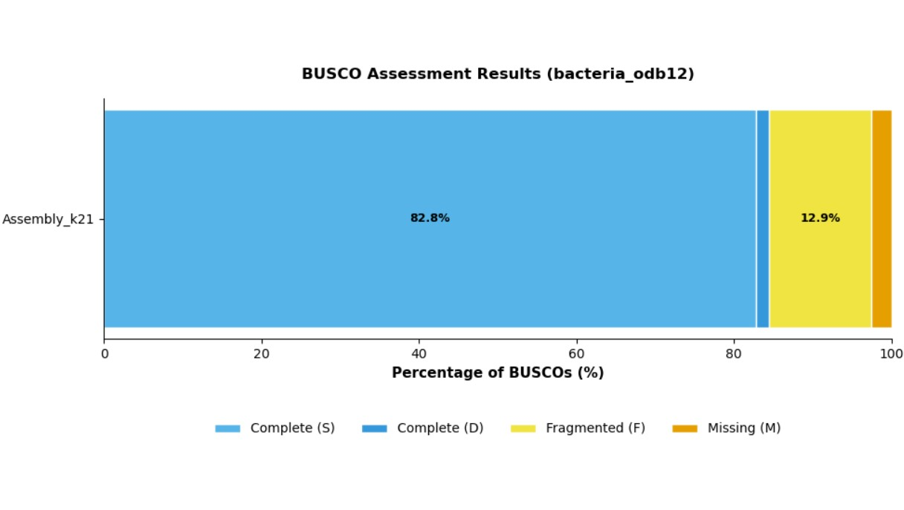
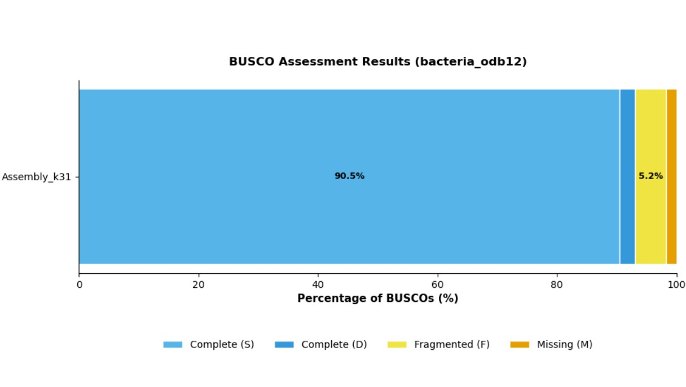
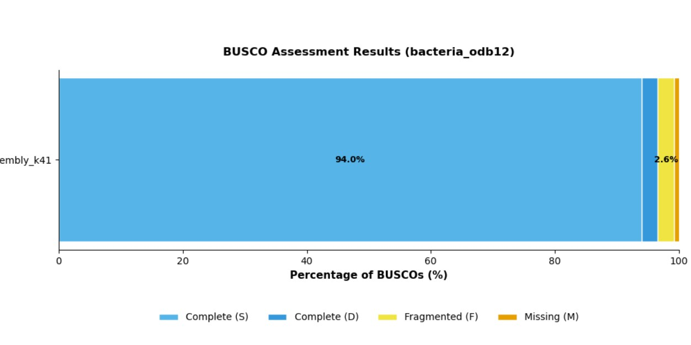

### Interpretation
- **N50 / N90:** larger k improved length metrics dramatically — N50 rose more than fourfold from 4,398 bp (k = 21) to 12,014 bp (k = 31) and peaked at 19,365 bp (k = 41); N90 rose from 1,416 to 3,422 to 5,455 bp. Higher k-mers resolve repetitive regions more efficiently, so the assembler builds much longer continuous sequences before hitting graph bifurcations.
- **L50 / L90:** the number of contigs needed to cover 50 % and 90 % of the assembly dropped sharply (L50 402 → 152 → 92; L90 1,297 → 510 → 305). A lower L-value with a higher N-value means reduced fragmentation.
- **Overall:** total length (~6.0–6.1 Mb) and GC (~43 %) were uniform, but k = 41 gave the highest structural integrity: the largest contig (95,763 bp) and the fewest contigs to reconstruct most of the genome.
- **BUSCO k = 21:** moderate completeness with noticeable fragmentation; the small k-mer overlap breaks coding sequences across contig ends.
- **BUSCO k = 31:** completeness +8.6 points (84.5 → 93.1 %) and fragmentation more than halved (12.9 → 5.2 %), confirming that better contiguity preserves coding sequence integrity.
- **BUSCO k = 41:** highest completeness (96.6 %), lowest fragmentation (2.6 %); extended overlaps span complex coding regions.
- **Summary:** k = 41 is the optimal assembly for downstream functional annotation, maximising full-length gene recovery while minimising fragmentation.

---
## C. Effect of sequencing depth (3 M, 5 M, 10 M read pairs, k = 31)
**Aim:** evaluate how read depth changes assembly contiguity, metrics and completeness at fixed k = 31, from the primary input files `SR1`/`SR2`.

### Procedure
1. Subsample with `seqtk sample -s100` to 3,000,000 / 5,000,000 / 10,000,000 reads per mate (`01_subsample_reads.sh`).
2. Velvet at k = 31, `-cov_cutoff 5 -unused_reads yes` → `Assembly_3M/`, `Assembly_5M/`, `Assembly_10M/` (`02_velvet_depth_series.sh`).
   *Problem recorded:* Velvet defaults to FASTQ parsing, which fails on FASTA headers of `SR1.fasta`/`SR2.fasta`. *Fix:* use `-fasta` instead of `-fastq` in `velveth` (the command listing in the report shows the subsampled `.fastq` files with `-fastq`).
3. QUAST on the three assemblies; BUSCO `bacteria_odb12` on each (`03_quast_and_busco.sh`).

### Results
| Depth | N50 | N90 | L50 | L90 | Contigs > 500 bp | Largest contig | BUSCO C / F / M |
|---|---|---|---|---|---|---|---|
| 3 M | 12,014 | 3,422 | 152 | 510 | 878 | 63,467 | 93.1 / 5.2 / 1.7 % |
| 5 M | 12,014 | 3,422 | 152 | 510 | 878 | 63,467 | 93.1 / 5.2 / 1.7 % |
| 10 M | 12,014 | 3,422 | 152 | 510 | 878 | 63,467 | 93.1 / 5.2 / 1.7 % |

Filtered assembly length 6,002,093 bp and GC 42.97 % in all three; total contigs (all sizes) ranged 1,683–1,694. BUSCO in each: 108 complete genes (105 single-copy + 3 duplicated), 6 fragmented, 2 missing.

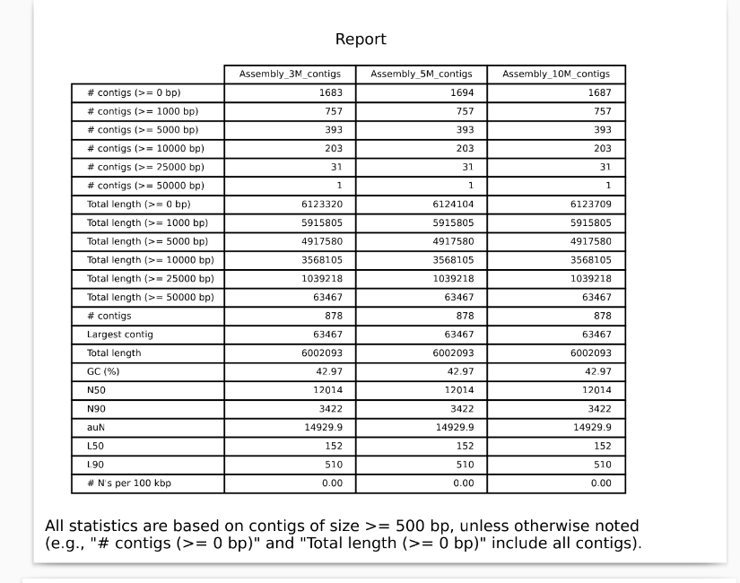
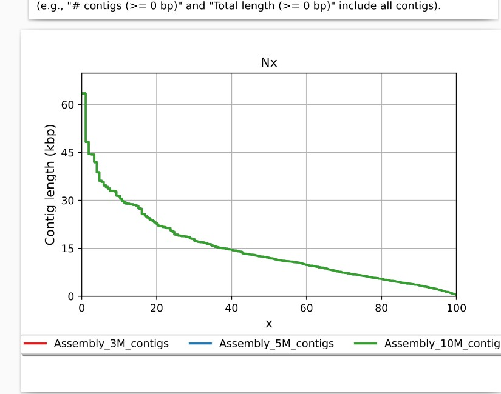
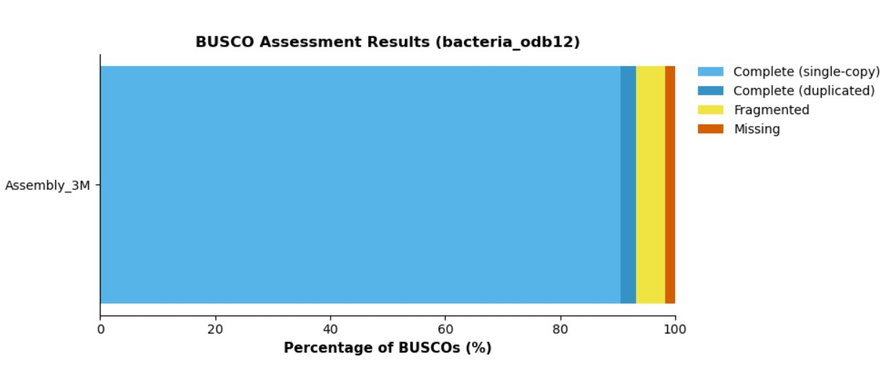
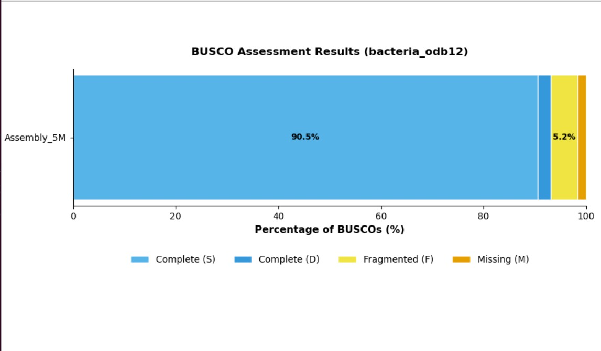
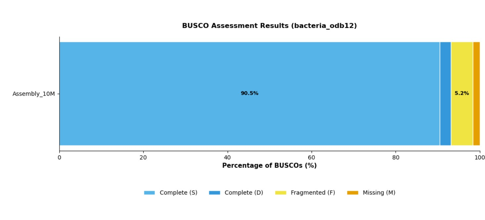

### Interpretation
- **N50 / N90 stability:** N50 stayed exactly 12,014 bp and N90 3,422 bp across all depths, so going beyond 3 M reads adds no contiguity under these graph parameters.
- **L50 / L90:** fixed at 152 and 510 contigs; the filtered contig count (> 500 bp) stayed 878 and the largest contig 63,467 bp.
- **Length and GC:** filtered length (6,002,093 bp) and GC (42.97 %) were identical; only tiny contigs below 500 bp varied (1,683–1,694 total contigs).
- **Conclusion:** at k = 31, 3 M reads already reach maximum assembly saturation; 5 M or 10 M add redundant coverage without resolving more graph complexity.
- **BUSCO:** identical across 3 M, 5 M and 10 M (93.1 % complete, 5.2 % fragmented, 1.7 % missing). At k = 31 the graph resolution limit is governed by k-mer length rather than coverage, so 3 M reads suffice for maximum gene discovery. For 3 M the report adds that an N50 of ~11 kbp over 1,683 contigs indicates structural fragmentation that splits a small fraction of coding regions.

## Files
```
scripts/   a_baseline_assembly/ (4 .sh)   b_kmer_experiment/ (3 .sh)   c_depth_experiment/ (3 .sh)
results/   a_baseline_assembly/ (8 .png)  b_kmer_experiment/ (5 .png)  c_depth_experiment/ (5 .png)
reports/   Debarshi_day_20_8.pdf  k_mer_change_Debarshi.pdf  depth_change_Debarshi.pdf
```
